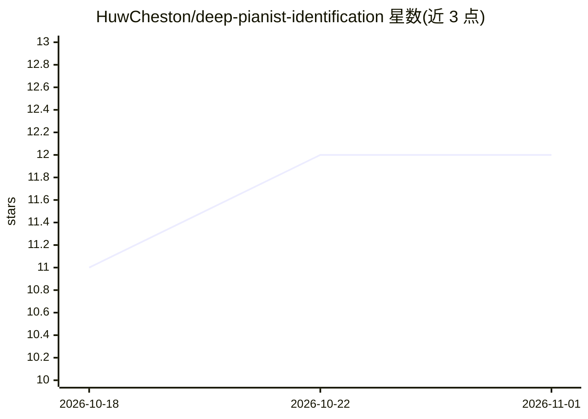

# HuwCheston/deep-pianist-identification

⭐ 12 · Python · MIT · 推送 2026-05-22 · [GitHub](https://github.com/HuwCheston/deep-pianist-identification) · [官网](https://huwcheston.github.io/ImprovID-app/index.html) · 组织维护

**爵士钢琴家识别论文代码：训练模型并复现实验结果**

论文 "Machine Learning of Artistic Fingerprints in Jazz" 的配套代码库，面向科研复现者。包含手工特征模型、神经网络架构（含多输入架构）与可解释性技术的复现流程，数据与模型检查点从 Zenodo 归档下载。提供预训练多输入模型在留出测试集上的一键推理脚本，并附带交互式 Web 应用与测试套件。开发测试环境为 Ubuntu 22.04、Python 3.10、CUDA 12.2，依赖通过 Poetry 管理。

## 筛选速览

| 维度 | 判定 | 备注 |
|---|---|---|
| AI 角色 | `ai-native` | 本体是模型或模型工具 |
| 许可风险 | `permissive` | MIT |
| 部署形态 | `library` | 以包/库形式分发 |
| 模型依赖 | — | README 未给出锁定关系 |
| 硬件要求 | — | 无带数字的原话,不猜 |
| 安装摩擦 | `medium` | 含编译或系统依赖之一 |
| 成熟度 | — | 结构信号不足 |

## 能力要点

- 复现论文手工特征模型与神经网络（含多输入架构）的结果
- 预训练多输入模型的测试集推理脚本
- 可解释性技术复现流程与交互式 Web 应用
- 数据与模型检查点通过 Zenodo 归档分发

## 适用场景

- 复现论文的实验结果与图表
- 用预训练模型对留出测试数据快速推理
- 重建并运行论文配套的交互式 Web 应用

## 场景标签

`科研工具` · 领域:学习与行业

## 证据(README 行号)

> L8: This repository accompanies our paper "Machine Learning of Artistic Fingerprints in Jazz". For more information, see
> L51: - To reproduce the results from the handcrafted features models described in section 3. of our paper,

## 星数曲线

2026-10-18 11 → 2026-11-01 12（+1）

---
*卡片 v1 · prompt 1.4 · 生成 2026-11-01 · 置信度 mid · 依据 README sha `9cdb4c652be4` · [字段定义](../../DATASET.md)*
