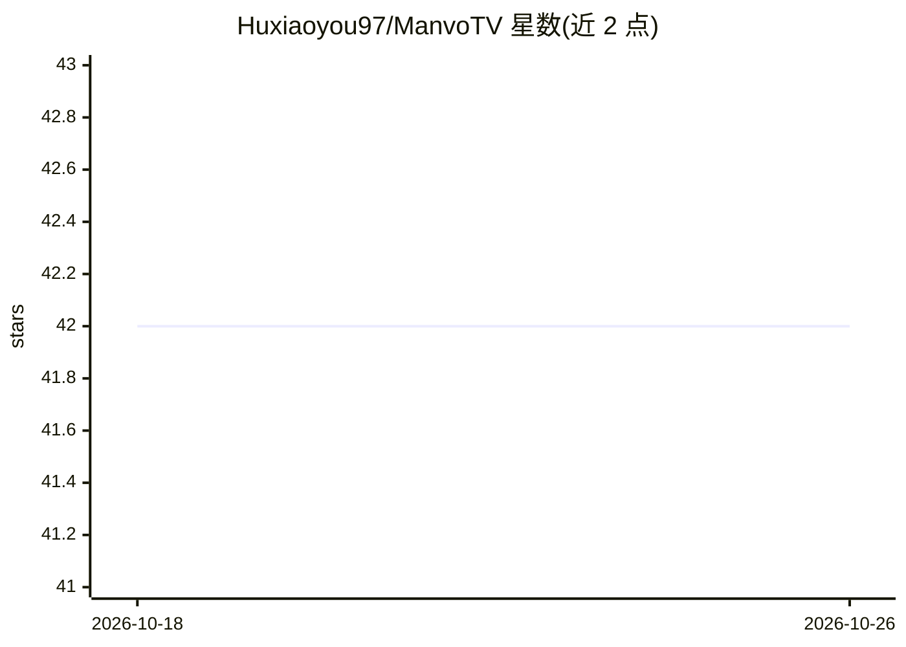

# Huxiaoyou97/ManvoTV

⭐ 42 · 推送 2026-06-21 · [GitHub](https://github.com/Huxiaoyou97/ManvoTV) · [官网](https://manvo.tv) · 组织维护 · 中文 README

**AI 短剧/漫剧创作平台：无限画布+剧本工厂一站式生成**

纯网页形式的闭源 SaaS 创作平台（本仓库仅用于产品展示，不含源代码），面向 AI 短剧、漫剧、广告片创作者。两大能力：无限画布（多模态节点、连线成组、AI 生成内嵌、多人实时协同）与漫剧剧本工厂（剧本解析→大纲分集→角色/场景资产卡→九宫格故事板→批量出图出视频）。算力可用平台内置（免费注册）或自带 API，支持零代码 JSON 插件接入任意模型。访问 manvo.tv 即用，免安装。

## 筛选速览

| 维度 | 判定 | 备注 |
|---|---|---|
| AI 角色 | `ai-native` | 本体是模型或模型工具 |
| 许可风险 | `none` | — |
| 部署形态 | `None` |  |
| 模型依赖 | — | README 未给出锁定关系 |
| 硬件要求 | — | 无带数字的原话,不猜 |
| 安装摩擦 | `low` | 无编译、无系统依赖或容器化 |
| 成熟度 | — | 结构信号不足 |

## 能力要点

- 无限画布：文本/图片/视频/音频/AI 生成节点连线成组，多人实时协同
- 漫剧剧本工厂：剧本→大纲→角色场景资产卡→九宫格分镜→批量出图出视频流水线
- 角色/场景资产卡作为全剧视觉基准，镜头统一引用参考图
- 零代码插件市场：粘贴 JSON 接入任意自有模型，或自带 API

## 适用场景

- 从一句创意生成脚本、拆分镜并批量出图出视频
- 让角色和场景在几十上百个镜头里保持视觉一致
- 多人团队在同一张画布上协同创作

## 场景标签

`视频生成` `图像生成` · 领域:内容生成

## 证据(README 行号)

> L19: **Manvo TV** 是一个面向 AI 短剧 / 漫剧 / 广告片创作者的一站式平台。它由两块咬合在一起的能力组成：
> L5: **面向创作者的 AI 原生创作平台 —— 把「从一句想法到一条成片」的整条路，收进同一个工作空间。**
> L128: *本仓库仅用于产品展示与推广，包含的文字与截图均为 Manvo TV 知识产权，未经授权不得转载、复制或用于商业用途。本产品为闭源软件，本仓库不包含任何源代码。*

## 星数曲线

2026-10-18 42 → 2026-10-26 42（+0）

---
*卡片 v1 · prompt 1.4 · 生成 2026-10-25 · 置信度 high · 依据 README sha `68f77ac6ec79` · [字段定义](../../DATASET.md)*
