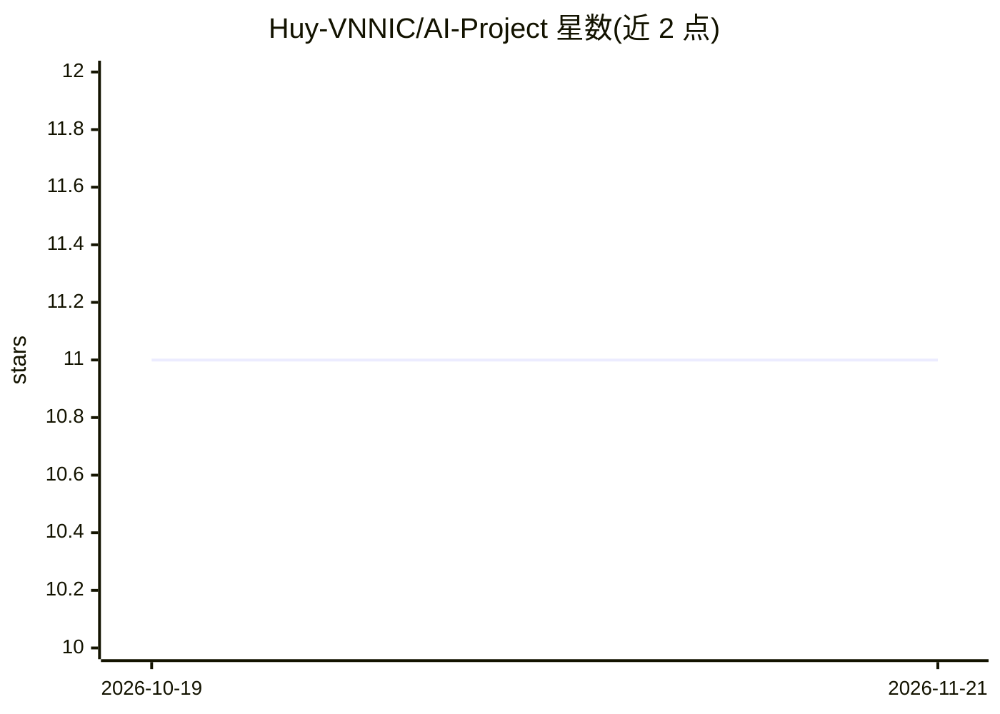

# Huy-VNNIC/AI-Project

⭐ 11 · Jupyter Notebook · 推送 2026-05-14 · [GitHub](https://github.com/Huy-VNNIC/AI-Project) · 个人维护

**面向开发者的软件工作量估算工具（COCOMO II 与机器学习模型）**

提供软件工作量估算工具集，包含 COCOMO II 传统模型与机器学习方法两类估算路径，并有多模型集成模块。工程以 Flask/FastAPI Web 应用形式提供 API 路由与端点，含需求分析器（analyzer）与反馈系统；仓库同时收录数据处理脚本、模型训练工具、Jupyter 分析笔记本、部署 shell 脚本与 Docker/Nginx 配置。安装方式为克隆仓库后用 pip 安装 requirements.txt。README 未给出各模型的具体输入输出说明。

## 筛选速览

| 维度 | 判定 | 备注 |
|---|---|---|
| AI 角色 | `ai-native` | 本体是模型或模型工具 |
| 许可风险 | `none` | — |
| 部署形态 | `self-host` | docker 或自建部署 |
| 模型依赖 | — | README 未给出锁定关系 |
| 硬件要求 | — | 无带数字的原话,不猜 |
| 安装摩擦 | `low` | 无编译、无系统依赖或容器化 |
| 成熟度 | — | 结构信号不足 |

## 能力要点

- 提供 COCOMO II 与机器学习两类工作量估算模型
- 多模型集成模块（multi_model）
- Flask/FastAPI Web 应用提供 API 端点与 /docs 文档
- 附带需求分析器与反馈系统模块

## 适用场景

- 估算软件项目的工作量与规模
- 通过 API 调用需求分析器处理需求文档
- 用 Jupyter 笔记本复现数据分析与模型演示

## 场景标签

`数据分析` `模型训练` · 领域:效率与自动化

## 证据(README 行号)

> L3: This project provides tools for software effort estimation using various models including COCOMO II and machine lear
> L15:  - **models/**: ML models
> L17:  - **ml_models/**: Machine learning models

## 星数曲线

2026-10-19 11 → 2026-11-21 11（+0）

---
*卡片 v1 · prompt 1.4 · 生成 2026-11-19 · 置信度 low · 依据 README sha `eddb3316957a` · [字段定义](../../DATASET.md)*
