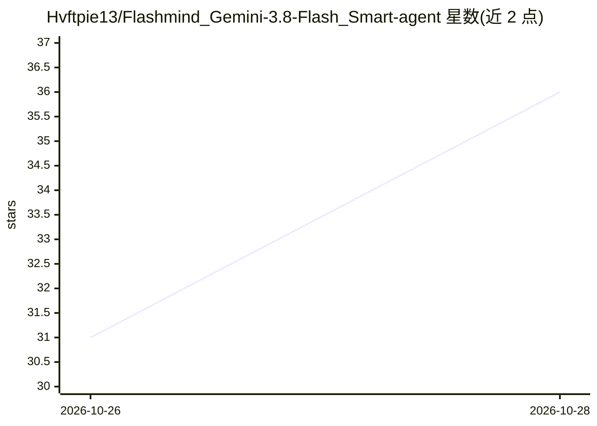

# Hvftpie13/Flashmind_Gemini-3.8-Flash_Smart-agent

⭐ 36 · JavaScript · MIT · 推送 2026-10-26 · [GitHub](https://github.com/Hvftpie13/Flashmind_Gemini-3.8-Flash_Smart-agent) · 个人维护

**给 Gemini 等编码代理加持久记忆、技能与防幻觉规则的插件**

面向 AI 编码代理的可组合增强插件：通过 Engram MCP 服务器提供跨编辑器共享的本地持久记忆（任务开始自动召回历史决策、结束前保存新经验，本地数据库存储）；通过 GEMINI.md/AGENTS.md 规则文件强制引用代码证据、区分事实与假设；附 4 个按需加载的代理技能（计划优先、禁止虚构代码、系统化调试、完成前验证）。支持 Gemini CLI、Antigravity、Cursor、VS Code、Windsurf、Claude Code 及任意 MCP 客户端，提供 NPX、Gemini CLI 扩展与自动安装脚本三种安装方式，零第三方运行时依赖、无遥测。

## 筛选速览

| 维度 | 判定 | 备注 |
|---|---|---|
| AI 角色 | `ai-ecosystem` | LLM/agent 周边工具 |
| 许可风险 | `permissive` | MIT |
| 部署形态 | `library` | 以包/库形式分发 |
| 模型依赖 | — | README 未给出锁定关系 |
| 硬件要求 | — | 无带数字的原话,不猜 |
| 安装摩擦 | `low` | 无编译、无系统依赖或容器化 |
| 成熟度 | — | 结构信号不足 |

## 能力要点

- Engram MCP 跨工具共享本地持久记忆（存储于 ~/.engram/）
- 4 个按需加载的代理技能（规划/调试/验证/防虚构）
- 反幻觉规则文件强制引用代码证据并区分事实与假设
- 适配 6 种客户端及任意 MCP 客户端，含 /memory 与 /verify 斜杠命令

## 适用场景

- 让编码代理跨会话记住项目的架构决策与历史 bug
- 约束 AI 编码输出、减少虚构包名与未经验证的修改声明
- 在多个编辑器/CLI 之间共享同一份记忆与规则

## 场景标签

`Agent 记忆` · 领域:Agent 开发

## 证据(README 行号)

> L5: Persistent cross-tool memory via Engram · 4 proactive coding skills · strict anti-hallucination rules.
> L23: 1. 🧠 **Shared Memory (Engram MCP)**: Automatically recalls previous project bugs and decisions at the start of a ta
> L33: ```json

## 星数曲线



2026-10-26 31 → 2026-10-28 36（+5）


---
*卡片 v1 · prompt 1.4 · 生成 2026-10-27 · 置信度 high · 依据 README sha `15b22ebe28e4` · [字段定义](../../DATASET.md)*
