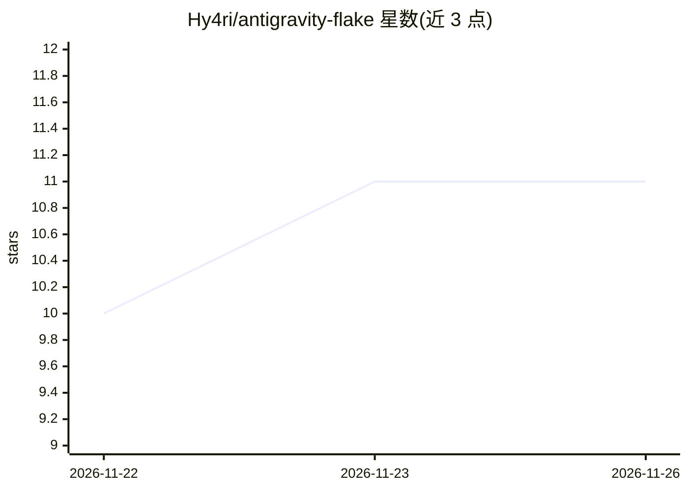

# Hy4ri/antigravity-flake

⭐ 11 · Nix · 推送 2026-11-25 · [GitHub](https://github.com/Hy4ri/antigravity-flake) · [官网](https://antigravity.google/) · 个人维护

**用 Nix flake 安装 Google Antigravity 全家桶的工具**

面向使用 NixOS、Home Manager、nix-darwin 或任意 Nix 系统的用户，提供 Google Antigravity 系列 5 个包的安装：CLI（agy 命令）、桌面 Hub、桌面 IDE（含 Linux FHS 变体）与 Python SDK（已对捆绑二进制做 Nix 修补）。提供 nix run 免安装试用、overlay 与直接包两种安装路径，支持 Linux x86_64/aarch64 与 macOS Intel/Apple Silicon。由 GitHub Action 每日自动检查新版并提交更新，flake 本身只下载打包官方发布物，标记为 unfree。

## 筛选速览

| 维度 | 判定 | 备注 |
|---|---|---|
| AI 角色 | `ai-ecosystem` | LLM/agent 周边工具 |
| 许可风险 | `none` | — |
| 部署形态 | `None` |  |
| 模型依赖 | — | README 未给出锁定关系 |
| 硬件要求 | — | 无带数字的原话,不猜 |
| 安装摩擦 | `low` | 无编译、无系统依赖或容器化 |
| 成熟度 | — | 结构信号不足 |

## 能力要点

- 提供 CLI、桌面 Hub、桌面 IDE、FHS 变体与 Python SDK 共 5 个包
- 支持 NixOS、Home Manager、nix-darwin 及任意 Nix 系统
- overlay 与 direct package 两种安装方式可选
- GitHub Action 每日自动检测新版本并测试构建

## 适用场景

- 在 NixOS 上以声明式方式安装并管理 Antigravity IDE 与 CLI
- 在 Home Manager 配置中为多用户统一部署 Antigravity 工具
- 通过 nix run 免安装试用桌面 IDE
- 在 Nix dev shell 中引入 Antigravity Python SDK

## 场景标签

 · 领域:开发工具/Nix 打包

## 证据(README 行号)

> L8: Run and install the Google Antigravity tools on NixOS, Home Manager, nix-darwin, or any system with Nix: the CLI, th
> L117: The Antigravity apps are proprietary software by Google, under the Google Antigravity license terms; Nix marks the

## 星数曲线

2026-11-22 10 → 2026-11-26 11（+1）

---
*卡片 v1 · prompt 1.4 · 生成 2026-11-22 · 置信度 mid · 依据 README sha `26a5aa03dde6` · [字段定义](../../DATASET.md)*
