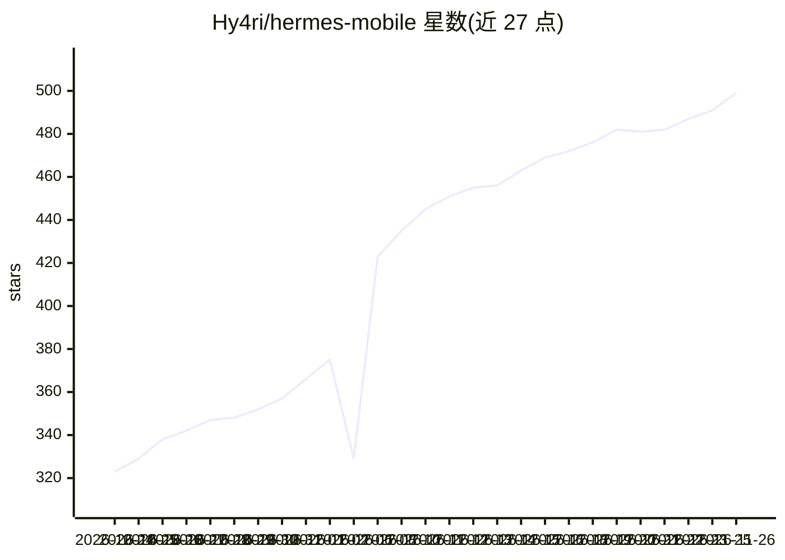

# Hy4ri/hermes-mobile

⭐ 499 · Kotlin · Apache-2.0 · 推送 2026-11-25 · [GitHub](https://github.com/Hy4ri/hermes-mobile) · [官网](https://hy4ri.github.io/hermes-mobile/) · 个人维护

**Hermes Agent 的 Android 原生客户端：手机端对话与管理**

面向 Hermes Agent 用户的原生 Android 客户端，基于 Kotlin 与 Jetpack Compose 构建。通过 REST API 与 WebSocket 网关连接运行在主机上的 Hermes dashboard，可在手机上与 agent 聊天、管理 cron 任务、技能、插件、模型/提供商选择、查看实时日志、Kanban 任务板、会话历史与用量分析。聊天历史本地存储于 Room，通知支持内联回复。需先在可达主机上运行 dashboard 才能使用，提供 F-Droid、Obtainium 与 GitHub Release APK 三种安装途径。

## 筛选速览

| 维度 | 判定 | 备注 |
|---|---|---|
| AI 角色 | `ai-ecosystem` | LLM/agent 周边工具 |
| 许可风险 | `permissive` | Apache-2.0 |
| 部署形态 | `None` |  |
| 模型依赖 | — | README 未给出锁定关系 |
| 硬件要求 | — | 无带数字的原话,不猜 |
| 安装摩擦 | `low` | 无编译、无系统依赖或容器化 |
| 成熟度 | — | 结构信号不足 |

## 能力要点

- 经 REST API 与 WebSocket 网关连接 Hermes dashboard
- 聊天历史本地存储（Room），通知支持内联回复
- 管理技能、插件、模型选择、cron 任务与实时日志
- 七种主题预设及 Material You 动态配色

## 适用场景

- 在手机上随时与自己的 Hermes Agent 对话
- 远程管理 agent 的 cron 任务、技能与模型配置
- 查看 agent 运行日志、MCP 服务器与连接状态

## 场景标签

`聊天机器人` · 领域:对话与助手

## 证据(README 行号)

> L2:  Native Android companion app for your Hermes AI agent.
> L23: Hermes Mobile is a native Android app for your Hermes Agent. Chat with your agent and manage cron jobs, skills, mod
> L25: The app connects to the Hermes dashboard over its REST API and WebSocket gateway, so the dashboard must run on a ho

## 星数曲线

2026-10-24 323 → 2026-11-26 499（+176）

---
*卡片 v1 · prompt 1.4 · 生成 2026-11-25 · 置信度 high · 依据 README sha `ad7503c18761` · [字段定义](../../DATASET.md)*
