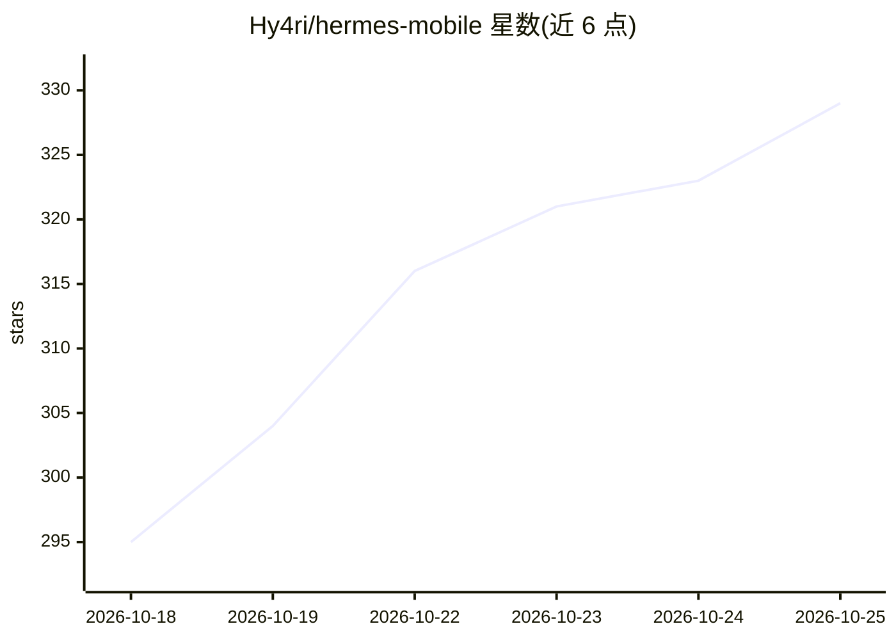

# Hy4ri/hermes-mobile

⭐ 338 · Kotlin · Apache-2.0 · 推送 2026-10-24 · [GitHub](https://github.com/Hy4ri/hermes-mobile) · [官网](https://hy4ri.github.io/hermes-mobile/) · 个人维护

**在 Android 手机上控制 Hermes AI agent 的原生客户端**

原生 Android 应用（Kotlin/Jetpack Compose），通过 REST API 与 WebSocket 连接自托管的 Hermes dashboard，实现手机端与 agent 对话（本地 Room 存储历史、通知内联回复）、管理 cron 任务、技能、插件、模型与供应商选择、流式查看日志、Kanban 任务与用量分析等。需先在可访问的主机上运行 Hermes dashboard，支持 Token、Basic auth 与 mTLS 客户端证书认证，提供可选应用锁。经 F-Droid、Obtainium 或 GitHub Release APK 分发，minSdk 26。README 大量篇幅描述 APK 校验、provenance 验证与隐私边界细节。

## 筛选速览

| 维度 | 判定 | 备注 |
|---|---|---|
| AI 角色 | `ai-ecosystem` | LLM/agent 周边工具 |
| 许可风险 | `permissive` | Apache-2.0 |
| 部署形态 | `None` |  |
| 模型依赖 | — | README 未给出锁定关系 |
| 硬件要求 | — | 无带数字的原话,不猜 |
| 安装摩擦 | `medium` | 含编译或系统依赖之一 |
| 成熟度 | — | 结构信号不足 |

## 能力要点

- 通过 REST + WebSocket 连接自托管 Hermes dashboard，手机端对话与管理 agent
- 管理 cron 任务、技能、插件、模型/供应商选择与实时日志
- 支持 Token、Basic auth 与 mTLS 客户端证书三种认证，可选应用锁
- 发布包含 SHA256SUMS 与 GitHub build provenance 校验

## 适用场景

- 在手机上随时与自托管的 Hermes agent 对话
- 远程管理 agent 的定时任务、技能与模型配置
- 查看 agent 运行日志与用量分析

## 场景标签

`AI 助手` · 领域:对话与助手

## 证据(README 行号)

> L23: **Hermes Mobile** is a native Android app for controlling your Hermes Agent from your phone. Chat with your agent, 
> L25: It connects to the Hermes dashboard (REST API and WebSocket gateway), so you need a running dashboard that your pho

## 星数曲线

2026-10-18 295 → 2026-10-25 329（+34）

---
*卡片 v1 · prompt 1.4 · 生成 2026-10-21 · 置信度 high · 依据 README sha `732d7e37ba55` · [字段定义](../../DATASET.md)*
