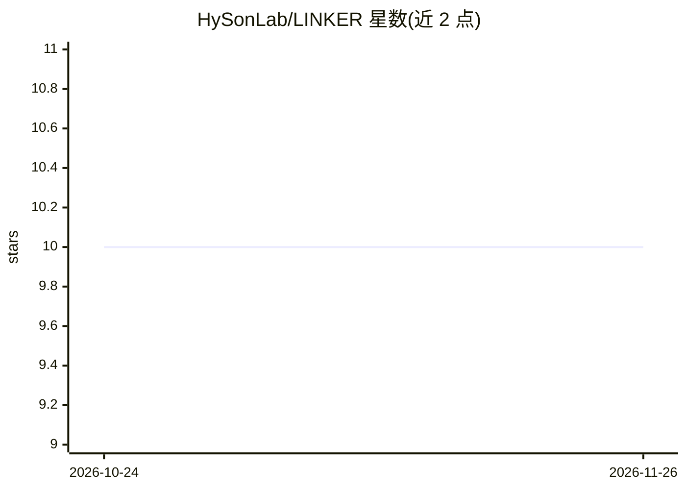

# HySonLab/LINKER

⭐ 10 · Jupyter Notebook · 推送 2026-07-16 · [GitHub](https://github.com/HySonLab/LINKER) · [官网](https://openreview.net/pdf?id=LsDdZUSVso) · 组织维护

**面向结构药物发现的蛋白-配体相互作用建模与解释框架**

LINKER 通过显式学习配体官能团与蛋白残基之间的相互作用，对蛋白-配体相互作用进行建模与解释，整合化学知识、结构信息与深度学习。基于 LP-PDBBind、BindingDB 3D、Davis 三个公开数据集，提供预处理、特征提取、数据加载、模型训练四阶段流水线脚本，含亲和力预测与 FINGERID-DTA 模型训练入口。依赖 Conda/pip 环境，并需单独安装 PLIP 与 pyCheckmol 两个外部工具。

## 筛选速览

| 维度 | 判定 | 备注 |
|---|---|---|
| AI 角色 | `ai-native` | 本体是模型或模型工具 |
| 许可风险 | `none` | — |
| 部署形态 | `library` | 以包/库形式分发 |
| 模型依赖 | — | README 未给出锁定关系 |
| 硬件要求 | — | 无带数字的原话,不猜 |
| 安装摩擦 | `low` | 无编译、无系统依赖或容器化 |
| 成熟度 | — | 结构信号不足 |

## 能力要点

- 显式建模配体官能团与蛋白残基间的相互作用
- 覆盖预处理、特征化、数据加载、训练四阶段的脚本化流水线
- 使用 LP-PDBBind、BindingDB 3D、Davis 三个公开数据集
- 论文发表于 JCIM，另有 NeurIPS 2025 AI for Science Workshop 版本

## 适用场景

- 在 PDBBind/BindingDB 数据上训练蛋白-配体结合亲和力预测模型
- 对药物发现中的蛋白-配体相互作用做官能团级别的解释分析
- 复现论文中 LINKER 与 FINGERID-DTA 模型的训练流程

## 场景标签

`模型训练` · 领域:训练与推理

## 证据(README 行号)

> L7: LINKER is a framework for modeling and explaining protein–ligand interactions by explicitly learning interactions be
> L3: Published at Journal of Chemical Information and Modeling (JCIM): https://pubs.acs.org/doi/10.1021/acs.jcim.6c00527

## 星数曲线

2026-10-24 10 → 2026-11-26 10（+0）

---
*卡片 v1 · prompt 1.4 · 生成 2026-11-20 · 置信度 high · 依据 README sha `249e1703cb58` · [字段定义](../../DATASET.md)*
