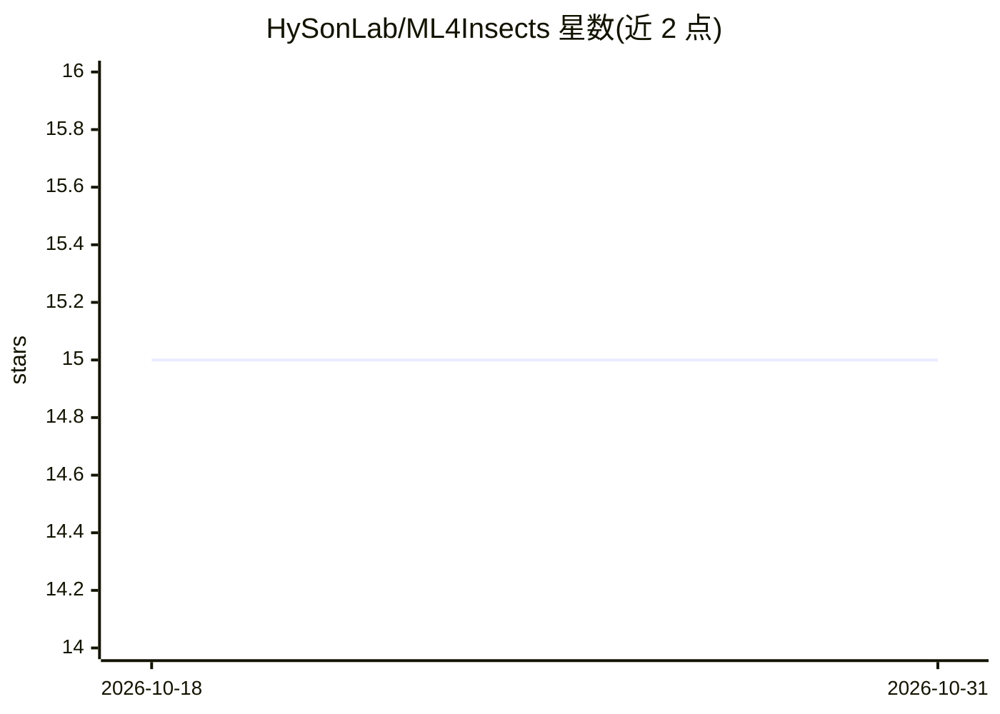

# HySonLab/ML4Insects

⭐ 15 · Jupyter Notebook · MIT · 推送 2026-02-18 · [GitHub](https://github.com/HySonLab/ML4Insects) · [官网](https://journals.plos.org/plosone/article?id=10.1371/journal.pone.0319484) · 组织维护

**蚜虫取食行为 EPG 信号自动分割与分析的 Python 库**

DiscoEPG 是面向刺吸式昆虫取食行为研究的开源 Python 库，兼容 Stylet+ EPG 系统。提供 EPG 记录可视化、基于滑窗的波形自动分割与标注、以及多种 EPG 参数计算。支持深度学习模型（CNN1D、ResNet、CNN2D）与传统机器学习模型（XGB、随机森林、逻辑回归）训练，预测结果可保存为 .ANA 文件供 Stylet+ 后处理。读取 .D0x 录制文件与 .ANA 标注文件组织数据集。研究工作发表于 PLOS ONE 与 Smart Agricultural Technology。

## 筛选速览

| 维度 | 判定 | 备注 |
|---|---|---|
| AI 角色 | `ai-native` | 本体是模型或模型工具 |
| 许可风险 | `permissive` | MIT |
| 部署形态 | `library` | 以包/库形式分发 |
| 模型依赖 | — | README 未给出锁定关系 |
| 硬件要求 | — | 无带数字的原话,不猜 |
| 安装摩擦 | `low` | 无编译、无系统依赖或容器化 |
| 成熟度 | — | 结构信号不足 |

## 能力要点

- 滑窗式 EPG 波形自动分割与标注，预测可导出 .ANA 文件
- 支持深度学习（CNN1D/ResNet/CNN2D）与传统 ML（XGB/随机森林/逻辑回归）模型训练
- 静态与交互式可视化，集成 plotly-resampler 处理大规模数据点
- 计算针对蚜虫的多种 EPG 参数

## 适用场景

- 自动分割与标注蚜虫 EPG 波形数据
- 可视化并计算 EPG 行为参数辅助昆虫-植物相互作用研究
- 训练 ML 模型检测 EPG 波形类型

## 场景标签

`科研工具` · 领域:学习与行业

## 证据(README 行号)

> L15: The DiscoEPG (abbreviated for Discover-EPG) package is an open-source Python package, designed to be compatible wit
> L21: ### ML for characterizing EPG waveforms

## 星数曲线

2026-10-18 15 → 2026-10-31 15（+0）

---
*卡片 v1 · prompt 1.4 · 生成 2026-10-31 · 置信度 high · 依据 README sha `b08b7696625f` · [字段定义](../../DATASET.md)*
