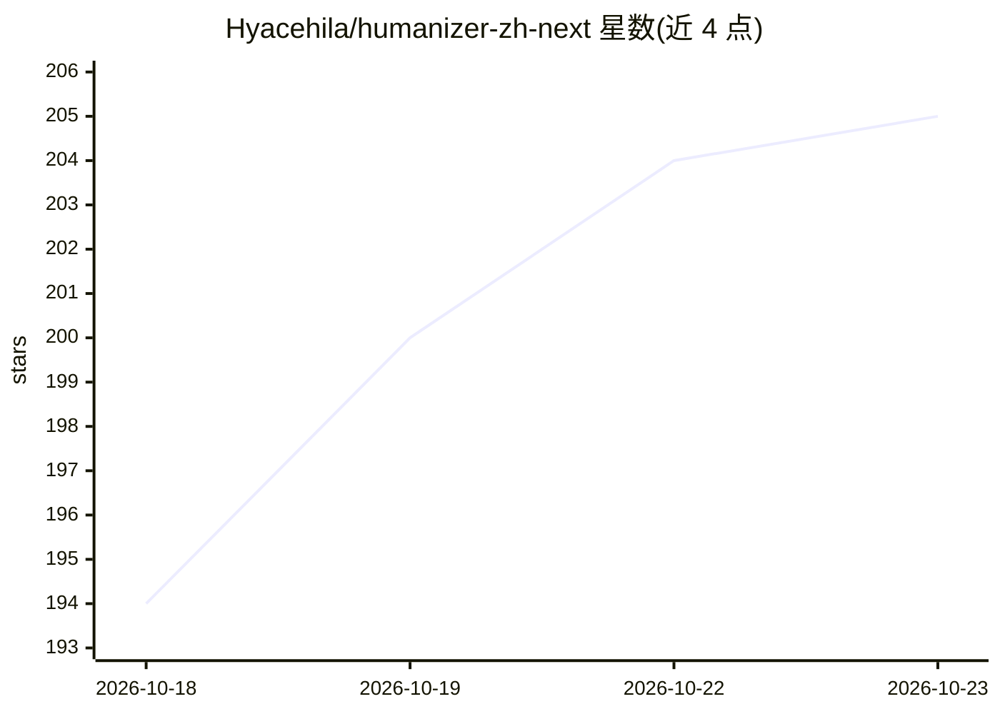

# Hyacehila/humanizer-zh-next

⭐ 205 · Python · MIT · 推送 2026-10-15 · [GitHub](https://github.com/Hyacehila/humanizer-zh-next) · 个人维护 · 中文 README

**去除中文文本 AI 写作痕迹的 Agent 编辑技能包**

供支持 Agent Skills 的环境（如 Claude 类 agent）读取执行的中英文文本编辑技能：以主 SKILL.md 集中 35 类通用模式、中文句法表达、体裁判断与文件保护规则，另设商务营销、学术写作、基金提案三个按需加载的 reference 分支。2.1.0 版针对学术防御性写作，减少重复免责与过度限定。无独立模型或在线服务，辅助检查脚本用 Python 3.10+ 标准库，普通文本编辑不依赖 Python。整合六个上游项目的编辑思路并保留来源记录与验证材料。

## 筛选速览

| 维度 | 判定 | 备注 |
|---|---|---|
| AI 角色 | `ai-knowledge` | 知识聚合/清单类 |
| 许可风险 | `permissive` | MIT |
| 部署形态 | `library` | 以包/库形式分发 |
| 模型依赖 | — | README 未给出锁定关系 |
| 硬件要求 | — | 无带数字的原话,不猜 |
| 安装摩擦 | `low` | 无编译、无系统依赖或容器化 |
| 成熟度 | — | 结构信号不足 |

## 能力要点

- 35 类通用模式带中文示例与适用边界
- 三个专用 reference 分支（商务/学术/基金）按需加载
- 文件模式保护代码、公式、数据、链接与标题
- 提供离线包检查脚本与结构检查、行为评测材料

## 适用场景

- 润色论文摘要或讨论段，减少防御性表达与重复免责
- 按写作样本匹配作者声音，保留原意与主张强度
- 商务营销文案的分维度审阅

## 场景标签

`AI 写作` · 领域:内容生成

## 证据(README 行号)

> L7: 这是一份由 Agent 读取执行的编辑技能，无独立模型或在线运行服务。辅助检查脚本使用 Python 3.10+ 标准库；普通文本编辑不依赖 Python。
> L3: 编辑已有中文文本中的空话、重复和模板化表达，保留原意、事实、确定程度和作者声音。通用模式、中文表达、体裁判断、原有的作者样本方法和文件保护都集中在主 SKILL.md，商务营销、学术写作和基金提案分别按需加载三个专用分支。

## 星数曲线

2026-10-18 194 → 2026-10-23 205（+11）

---
*卡片 v1 · prompt 1.4 · 生成 2026-10-22 · 置信度 mid · 依据 README sha `0bba61d084ac` · [字段定义](../../DATASET.md)*
