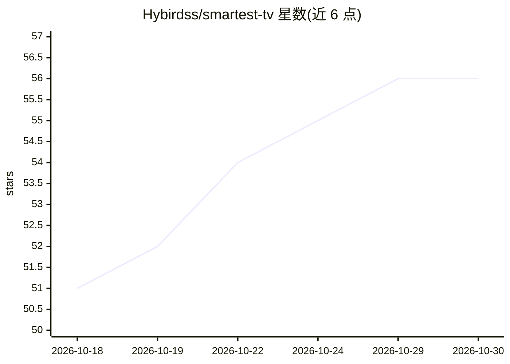

# Hybirdss/smartest-tv

⭐ 56 · Python · MIT · 推送 2026-10-02 · [GitHub](https://github.com/Hybirdss/smartest-tv) · 个人维护 · 中文 README

**用自然语言/命令行控制智能电视的 CLI 与 MCP 服务器**

Python 编写的电视控制 CLI（stv）：按名称在 Netflix、Apple TV+、Disney+ 等平台解析内容 ID 并深链到电视上的流媒体应用播放，支持 LG webOS、Samsung Tizen、Android TV/Fire TV、Roku 四种电视驱动；另提供投送 URL、播放队列、场景预设、多房间音频、多电视同步、观看统计等功能。同时可作为 MCP 服务器暴露 21 个工具，供 Claude Code、Cursor 等 MCP 客户端用自然语言控制电视；也提供 Home Assistant HACS 集成。无电视时可在浏览器打开内容。流媒体可用性数据来自 JustWatch，运行于本地网络，无遥测；未命中缓存时会匿名提交解析结果到社区缓存，可用 STV_NO_CONTRIBUTE=1 关闭。

## 筛选速览

| 维度 | 判定 | 备注 |
|---|---|---|
| AI 角色 | `ai-enhanced` | 去掉 AI 部分产品仍成立 |
| 许可风险 | `permissive` | MIT |
| 部署形态 | `library` | 以包/库形式分发 |
| 模型依赖 | — | README 未给出锁定关系 |
| 硬件要求 | — | 无带数字的原话,不猜 |
| 安装摩擦 | `low` | 无编译、无系统依赖或容器化 |
| 成熟度 | — | 结构信号不足 |

## 能力要点

- 按名称解析内容 ID 并深链到电视流媒体应用，无需登录与 API key
- 支持 LG webOS / Samsung Tizen / Android TV / Fire TV / Roku 四类电视驱动
- 作为 MCP 服务器提供 21 个工具，接入 Claude Code、Cursor 等客户端
- 提供 Home Assistant HACS 自定义集成与 CLI 两种使用方式

## 适用场景

- 在终端按剧名直接在电视上播放指定剧集
- 让 Claude 等 AI 客户端通过自然语言控制电视（播放、场景、关机）
- 在 Home Assistant 自动化中按名称播放内容
- 用电视做多房间音乐播放或信息看板

## 场景标签

`GUI 自动化` · 领域:效率与自动化

## 证据(README 行号)

> L7:  Play Netflix / Apple TV+ / YouTube / Spotify by name. Cast URLs. Multi-room audio. AI concierge. All from your term
> L183: stv is an **MCP server**. Claude, GPT, Cursor, or any MCP client can control your TV with natural language.
> L307: > Supports **LG webOS** · **Samsung Tizen** · **Android TV / Fire TV** · **Roku**

## 星数曲线

2026-10-18 51 → 2026-10-30 56（+5）

---
*卡片 v1 · prompt 1.4 · 生成 2026-10-24 · 置信度 high · 依据 README sha `e9e08d767bcb` · [字段定义](../../DATASET.md)*
