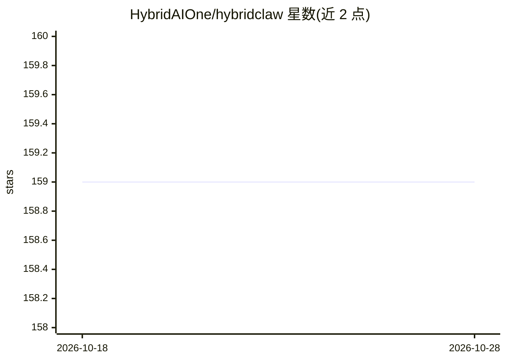

# HybridAIOne/hybridclaw

⭐ 159 · TypeScript · MIT · 推送 2026-10-27 · [GitHub](https://github.com/HybridAIOne/hybridclaw) · [官网](https://www.hybridclaw.io/) · 组织维护

**面向企业的自托管 AI 助手运行时，带沙箱与审批**

自托管的 AI 助手运行时：内置网关、Web 聊天、TUI、管理控制台与 OpenAI 兼容本地 API，提供 79 个捆绑技能（CRM/营销/分析/财务等业务助手，含评测场景与审批分级），并以 Qwen3.6-27B-FP8 作为小模型验证基线。支持多智能体间端到端加密 A2A 通信、加密运行时凭据存储与 SecretRef 隔离（密钥不进入模型上下文）、Docker/主机沙箱执行与哈希链审计。覆盖 Discord/Slack/Teams 等多渠道，可选 HybridAI 云托管。需 Node.js 22，推荐 Docker 做默认沙箱。

## 筛选速览

| 维度 | 判定 | 备注 |
|---|---|---|
| AI 角色 | `ai-native` | 本体是模型或模型工具 |
| 许可风险 | `permissive` | MIT |
| 部署形态 | `library` | 以包/库形式分发 |
| 模型依赖 | — | README 未给出锁定关系 |
| 硬件要求 | — | 无带数字的原话,不猜 |
| 安装摩擦 | `low` | 无编译、无系统依赖或容器化 |
| 成熟度 | — | 结构信号不足 |

## 能力要点

- 79 个捆绑业务技能，含评测场景、审批分级，以 Qwen3.6-27B-FP8 为小模型基线验证
- 凭据隔离：加密运行时存储 + SecretRef，密钥不进入模型上下文
- 本地代理智能体与可信对等实例间的加密 A2A 通信
- macOS 签名桌面应用、CLI 安装器、npm 全局安装三种部署方式

## 适用场景

- 企业内自托管可操作的业务 AI 助手（CRM/营销/财务工作流）
- 运行一组角色化智能体并跨实例协作
- 需要审批策略与审计轨迹的敏感操作场景
- 在 Apple Silicon Mac 上以 MLX 运行本地模型

## 场景标签

`AI 助手` `多智能体` `Agent 框架` · 领域:Agent 开发

## 证据(README 行号)

> L13: HybridClaw - Enterprise-ready self-hosted AI assistant runtime
> L68: |Assistants that can act, not just chat|A gateway, web chat, Apps gallery, TUI, admin console, scheduler, tools, an
> L131: |Skills|79 bundled skills, production business helpers, eval fixtures, packaged skill lifecycle, and human-distill

## 星数曲线

2026-10-18 159 → 2026-10-28 159（+0）

---
*卡片 v1 · prompt 1.4 · 生成 2026-10-22 · 置信度 high · 依据 README sha `891ffa54993c` · [字段定义](../../DATASET.md)*
