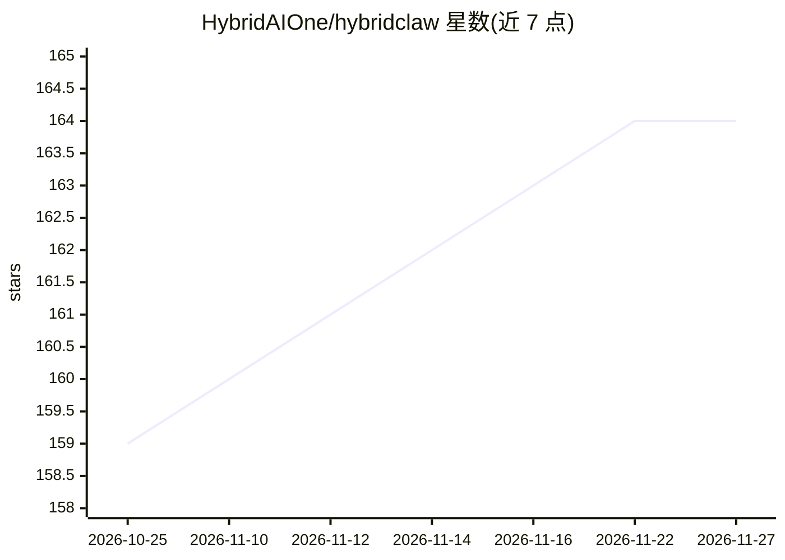

# HybridAIOne/hybridclaw

⭐ 164 · TypeScript · MIT · 推送 2026-11-26 · [GitHub](https://github.com/HybridAIOne/hybridclaw) · [官网](https://www.hybridclaw.io/) · 组织维护

**自托管企业 AI 助手运行时：沙箱执行、凭证隔离、审批与记忆**

自托管的 AI 助手运行时，以 npm 包与 macOS DMG 提供，核心是 Gateway 服务：对外接入 web chat、TUI、Discord/Slack/Teams/Telegram/邮件/语音等通道，内置 79 个业务技能（CRM、营销、分析、财务、办公等），以结构化 helper、eval 场景与审批分级支撑小模型（以 Qwen3.6-27B 为验证基线）。安全机制包括加密凭证存储与 SecretRef 执行时注入、LLM 输出视为不可信的审批策略、Docker 沙箱与哈希链审计。要求 Node.js >=22.23.4 <23。

## 筛选速览

| 维度 | 判定 | 备注 |
|---|---|---|
| AI 角色 | `ai-native` | 本体是模型或模型工具 |
| 许可风险 | `permissive` | MIT |
| 部署形态 | `library` | 以包/库形式分发 |
| 模型依赖 | — | README 未给出锁定关系 |
| 硬件要求 | — | 无带数字的原话,不猜 |
| 安装摩擦 | `low` | 无编译、无系统依赖或容器化 |
| 成熟度 | — | 结构信号不足 |

## 能力要点

- 79 个内置业务技能，带 eval 场景与审批分级，以 Qwen3.6-27B-FP8 为小模型验证基线
- 加密凭证存储与 SecretRef 机制，原始 API key 不进入模型上下文
- 本地、代理与对等实例间的端到端加密 A2A 通信与审批路由
- Apple silicon 上托管 MLX 本地模型，及 OpenAI 兼容的本地 API 端点

## 适用场景

- 自托管企业助手处理 CRM、营销、财务等业务工作流
- 通过审批策略与沙箱让助手执行敏感操作
- 在 Mac 上用本地模型运行带凭证隔离的助手
- 多通道（Discord/Slack/邮件等）统一接入同一助手运行时

## 场景标签

`AI 助手` `工作流自动化` · 领域:效率与自动化

## 证据(README 行号)

> L13: HybridClaw - Enterprise-ready self-hosted AI assistant runtime
> L68: |Assistants that can act, not just chat|A gateway, web chat, Apps gallery, TUI, admin console, scheduler, tools, an

## 星数曲线

2026-10-25 159 → 2026-11-27 164（+5）

---
*卡片 v1 · prompt 1.4 · 生成 2026-11-27 · 置信度 high · 依据 README sha `d1c6126548e3` · [字段定义](../../DATASET.md)*
