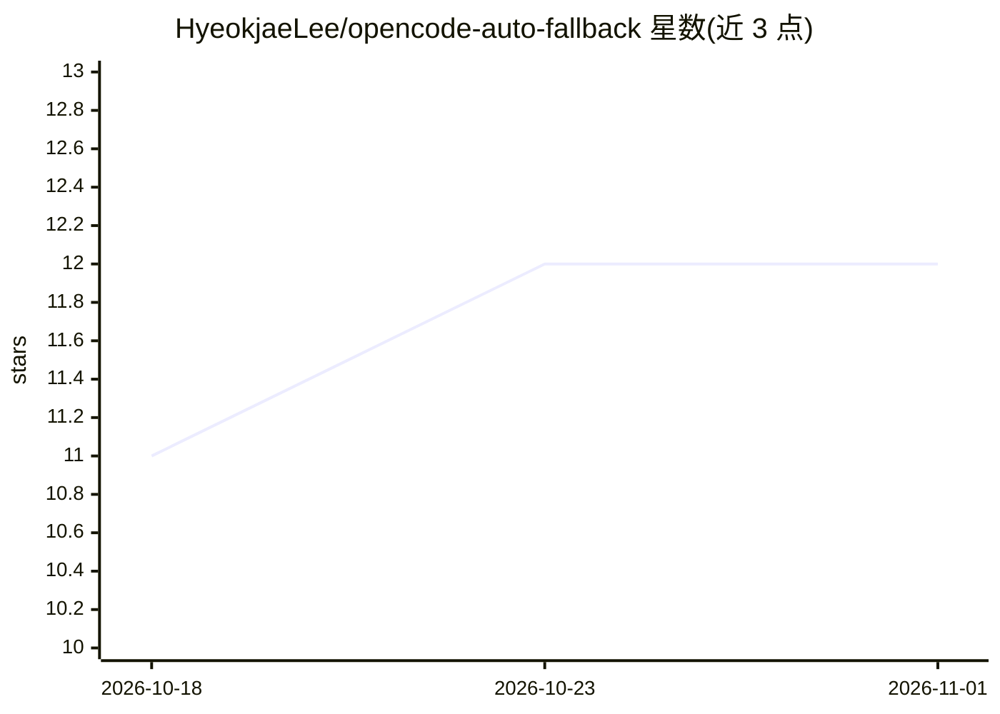

# HyeokjaeLee/opencode-auto-fallback

⭐ 12 · TypeScript · MIT · 推送 2026-10-18 · [GitHub](https://github.com/HyeokjaeLee/opencode-auto-fallback) · 个人维护

**OpenCode 插件：模型出错时自动切换备用链与重试**

面向 OpenCode 编码 agent 的插件：通过结构化 SDK 错误类型做两级分类——认证/配额类错误立即切换到按 agent 配置的备用模型链，限流与瞬时错误按指数退避（2s→4s→8s）重试后切换；失败模型进入定时冷却。上下文写满时可在同一会话内切到更大上下文模型并在压缩后切回，该特性及 prefill 恢复、压缩提示注入为 V1 专属，V2 因缺少相关 hook 不可用。首次运行自动生成 fallback.json，功能默认全部关闭，需设 enabled: true。

## 筛选速览

| 维度 | 判定 | 备注 |
|---|---|---|
| AI 角色 | `ai-ecosystem` | LLM/agent 周边工具 |
| 许可风险 | `permissive` | MIT |
| 部署形态 | `None` |  |
| 模型依赖 | — | README 未给出锁定关系 |
| 硬件要求 | — | 无带数字的原话,不猜 |
| 安装摩擦 | `low` | 无编译、无系统依赖或容器化 |
| 成熟度 | — | 结构信号不足 |

## 能力要点

- 基于结构化 SDK 错误类型的两级分类：认证类立即降级、瞬时类指数退避重试
- per-agent 备用模型链与继承机制，失败模型定时冷却
- 上下文写满时同会话切换大上下文模型，压缩后切回（V1 专属）
- 单一包同时支持 OpenCode V1（>=1.18.29）与 V2（>=2.0.x）

## 适用场景

- 长任务跑模型时自动处理限流与认证失败，减少人工干预
- 让 agent 上下文写满时自动切换大上下文模型继续工作
- 为不同 agent 配置各自的备用模型链

## 场景标签

`模型网关` · 领域:Agent 开发

## 证据(README 行号)

> L3: OpenCode plugin that automatically detects model errors and switches to a fallback model chain — with intelligent re
> L7: - **Two-tier classification**: immediate fallback for auth errors, exponential backoff retry for rate limits and tra

## 星数曲线

2026-10-18 11 → 2026-11-01 12（+1）

---
*卡片 v1 · prompt 1.4 · 生成 2026-11-01 · 置信度 high · 依据 README sha `c1d38e0ba88a` · [字段定义](../../DATASET.md)*
