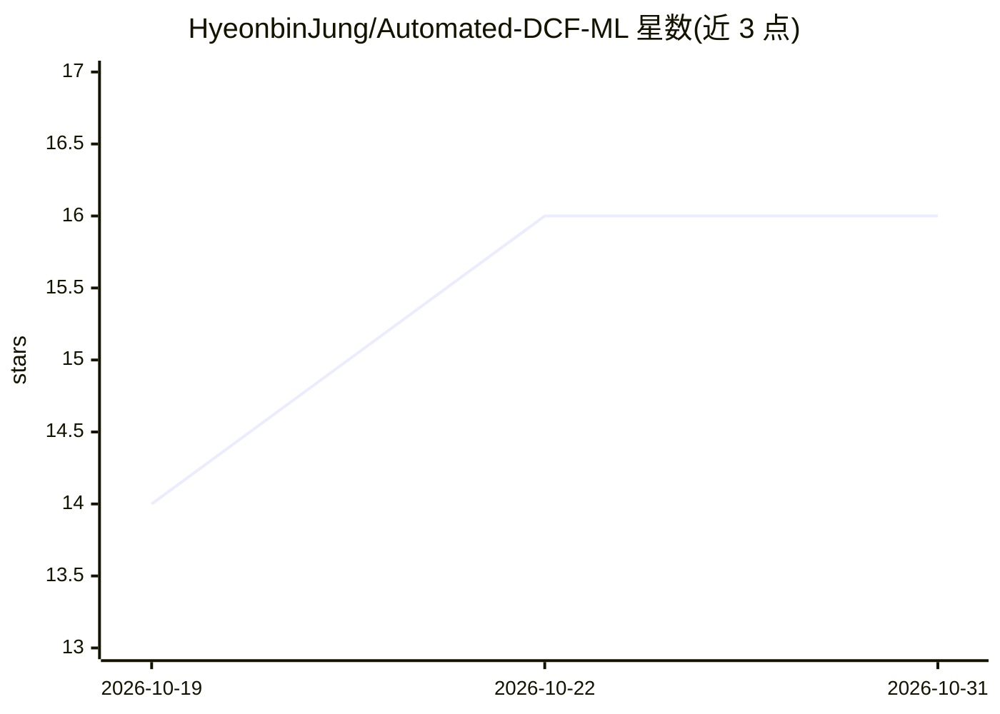

# HyeonbinJung/Automated-DCF-ML

⭐ 16 · Python · 推送 2026-10-13 · [GitHub](https://github.com/HyeonbinJung/Automated-DCF-ML) · 个人维护

**ML 驱动的 DCF 估值管线：预测六大价值驱动因子并算公平价值**

用 Ridge 与 Elastic Net 从 SEC XBRL（Company Facts API）历史基本面数据预测 DCF 所依赖的六个运营驱动因子——营收增长、EBIT 利润率、有效税率、D&A/营收、CapEx/营收、NWC/营收——再经标准 FCFF→DCF 框架得出公平价值，ML 层与估值层分离以保持可解释性。提供严格时序防泄漏回测（训练≤2018、间隔 2019–2021、测试≥2022）与多指标诊断，附带无需外部数据的合成面板演示。限制：演示数据为合成，SEC 数据不足以支撑完整模型，不适用于金融类公司。

## 筛选速览

| 维度 | 判定 | 备注 |
|---|---|---|
| AI 角色 | `ai-native` | 本体是模型或模型工具 |
| 许可风险 | `none` | — |
| 部署形态 | `library` | 以包/库形式分发 |
| 模型依赖 | — | README 未给出锁定关系 |
| 硬件要求 | — | 无带数字的原话,不猜 |
| 安装摩擦 | `low` | 无编译、无系统依赖或容器化 |
| 成熟度 | — | 结构信号不足 |

## 能力要点

- Ridge/Elastic Net 预测六个 DCF 驱动因子，ML 层与估值层分离
- 严格时序防泄漏回测与多指标诊断（R²、方向准确率、复合相关性指数等）
- SEC Company Facts (XBRL) API 数据采集器
- 合成面板可端到端运行全管线

## 适用场景

- 自动化上市公司 DCF 估值流程
- 研究 ML 能否替代 DCF 中的主观预测假设
- 复现时序防泄漏的财务预测回测框架

## 场景标签

`金融量化` · 领域:学习与行业

## 证据(README 行号)

> L11: Instead of predicting a stock price directly, this pipeline forecasts the **operating fundamentals** a DCF depends 
> L18: |🧠 **Regularized models**|Ridge and Elastic Net — interpretable, robust to correlated accounting variables and smal

## 星数曲线

2026-10-19 14 → 2026-10-31 16（+2）

---
*卡片 v1 · prompt 1.4 · 生成 2026-10-30 · 置信度 mid · 依据 README sha `3ce01717fd18` · [字段定义](../../DATASET.md)*
