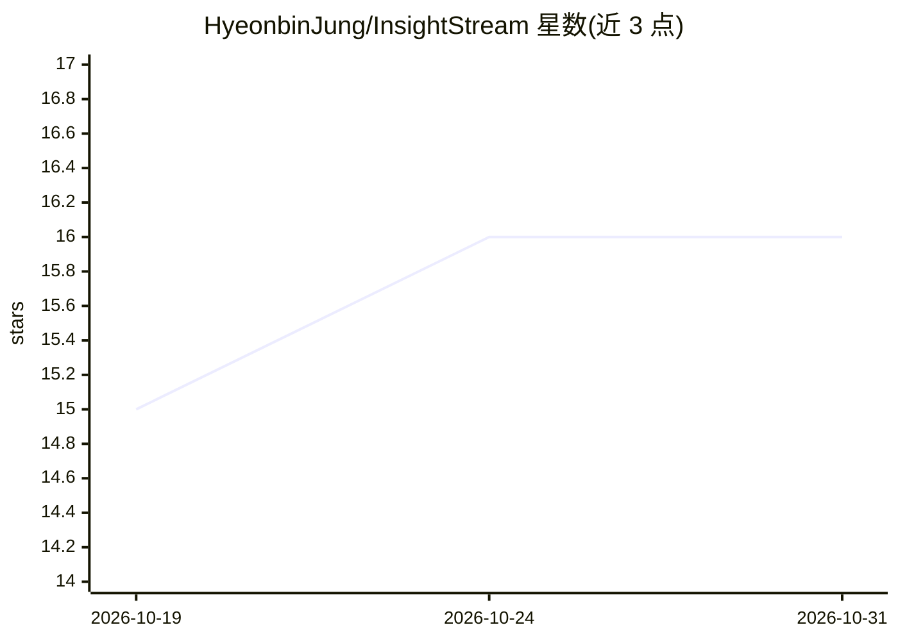

# HyeonbinJung/InsightStream

⭐ 16 · Kotlin · 推送 2026-10-13 · [GitHub](https://github.com/HyeonbinJung/InsightStream) · 个人维护

**实时日志流分析系统：Kafka 聚合日志，LLM 输出事件诊断**

为 DigitalOcean Gradient AI 黑客松构建的实时日志智能原型：日志经 Kafka 流入 Spring Boot（Kotlin）后端，按时间窗口聚合，由 DigitalOcean Gradient AI 托管的 Llama 3 8B Instruct 判定异常概率、严重度、根因与建议动作，结果经 Server-Sent Events 推送到 Next.js 仪表盘；另提供根因加权图、64 维哈希嵌入相似事件检索（pgvector，默认关闭）、自然语言问答 API 与场景模拟器。无 API key 时退回规则判定。作者声明为黑客松原型，未达生产配置。

## 筛选速览

| 维度 | 判定 | 备注 |
|---|---|---|
| AI 角色 | `ai-ecosystem` | LLM/agent 周边工具 |
| 许可风险 | `none` | — |
| 部署形态 | `self-host` | docker 或自建部署 |
| 模型依赖 | — | README 未给出锁定关系 |
| 硬件要求 | — | 无带数字的原话,不猜 |
| 安装摩擦 | `low` | 无编译、无系统依赖或容器化 |
| 成熟度 | `idea` | |

## 能力要点

- Kafka 流式摄取 + 时间窗口聚合分析
- LLM 生成事件报告：严重度/类别/证据/建议动作，无 key 时规则回退
- 根因加权图与相似历史事件检索（pgvector 可选）
- Next.js 实时仪表盘与四类场景模拟生成器

## 适用场景

- 实时观测系统日志并获得异常事件诊断
- 通过自然语言 API 询问系统状态
- 模拟错误激增、暴力登录等场景测试告警分析

## 场景标签

`LLM 可观测性` · 领域:评测与运维

## 证据(README 行号)

> L11: Modern systems produce millions of log lines an hour, and static threshold alerts catch problems late. **InsightStr
> L21: |🤖 **LLM incident reports**|Each window is analyzed by the Gradient-hosted model — severity, category, evidence and

## 星数曲线

2026-10-19 15 → 2026-10-31 16（+1）

---
*卡片 v1 · prompt 1.4 · 生成 2026-10-30 · 置信度 high · 依据 README sha `0f3fd34b5664` · [字段定义](../../DATASET.md)*
