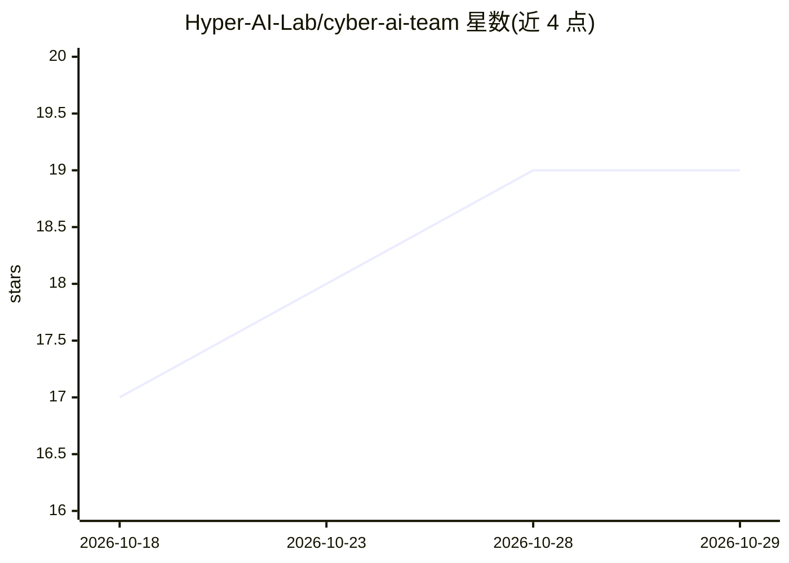

# Hyper-AI-Lab/cyber-ai-team

⭐ 19 · Python · MIT · 推送 2026-10-23 · [GitHub](https://github.com/Hyper-AI-Lab/cyber-ai-team) · [官网](https://github.com/Hyper-AI-Lab/cyber-ai-team#readme) · 组织维护

**给一人公司的自托管 AI 公司操作系统，多智能体协作+ERPNext 记录**

面向独立创始人、一人公司与小型初创的自托管 AI 公司操作系统：由首席运营 Agent、观察者 Agent 等 20 余个角色族组成受治理的 AI 员工团队，围绕人类所有者运行。核心机制包括四层长期记忆（身份/工作流/Qdrant 检索/PostgreSQL+ERPNext 权威业务记录）、影响阈值以下自主行动与高风险操作需所有者审批的人机协同治理、Observer Agent 独立审查与提示注入降级等安全模型。技术栈为 FastAPI+PostgreSQL+Redis+Next.js，Docker Compose 部署；LLM 默认走托管 OpenAI（显式计量例外），项目自称仍在快速演进。

## 筛选速览

| 维度 | 判定 | 备注 |
|---|---|---|
| AI 角色 | `ai-native` | 本体是模型或模型工具 |
| 许可风险 | `permissive` | MIT |
| 部署形态 | `self-host` | docker 或自建部署 |
| 模型依赖 | — | README 未给出锁定关系 |
| 硬件要求 | — | 无带数字的原话,不猜 |
| 安装摩擦 | `low` | 无编译、无系统依赖或容器化 |
| 成熟度 | `idea` | |

## 能力要点

- 20+ 角色族的受治理 AI 员工团队，可按需动态创建角色
- 四层记忆结构 + ERPNext 作为权威业务记录（CRM/会计/项目/工单）
- 所有者审批门、审计证据、提示注入降级等安全模型
- Next.js 所有者控制台 + Docker Compose 生产形态部署

## 适用场景

- 一人公司用 AI 员工承担销售、财务、客服等运营职能
- 开发者研究多智能体系统、记忆层与人在环 AI 治理
- 自托管替代托管型 agent SaaS 并保留审计能力

## 场景标签

`多智能体` `Agent 记忆` · 领域:Agent 开发

## 证据(README 行号)

> L10: **Cyber AI Team is a self-hosted AI company operating system for solo founders, one-person companies, and small dig
> L12: The goal is not another chatbot. The goal is a practical open-source foundation for an autonomous digital company: 
> L68: - Solo founders building AI-native businesses.

## 星数曲线

2026-10-18 17 → 2026-10-29 19（+2）

---
*卡片 v1 · prompt 1.4 · 生成 2026-10-29 · 置信度 mid · 依据 README sha `8729f067bdbd` · [字段定义](../../DATASET.md)*
