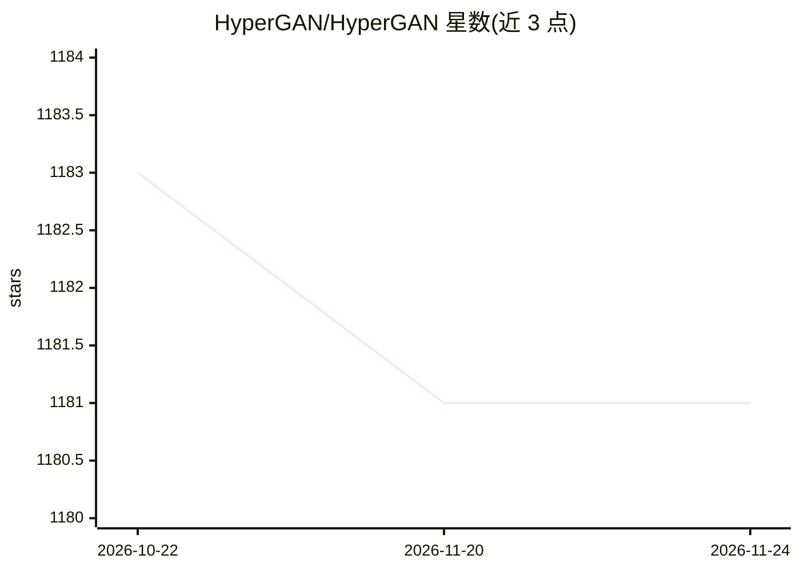

# HyperGAN/HyperGAN

⭐ 1,181 · Python · MIT · 推送 2026-11-22 · [GitHub](https://github.com/HyperGAN/HyperGAN) · [官网](https://hypergan.github.io/HyperGAN/) · 组织维护

**给开发者的 GAN 训练框架：从 TOML 声明文件训练并导出生成模型**

由 255labs 维护的开源框架，用声明式 TOML 文件定义生成对抗网络（HNDL 网络、ParticleGAN 配方），通过 CLI 或 Python API 训练、断点续训、采样、导出生成器用于部署。内置 Docker 风格的运行注册表（Run ID/Slug/标签）、多 GPU 队列、Web Observatory 实时观测界面（学习曲线、FID、吞吐）。训练需安装 PyTorch 2.6+，CI 仅测试 torch 2.14.0；GPU 加速依赖 NVIDIA CUDA 轮子，CPU 路径可运行轻量命令与玩具模板。多主机训练标注为实验性。

## 筛选速览

| 维度 | 判定 | 备注 |
|---|---|---|
| AI 角色 | `ai-native` | 本体是模型或模型工具 |
| 许可风险 | `permissive` | MIT |
| 部署形态 | `library` | 以包/库形式分发 |
| 模型依赖 | — | README 未给出锁定关系 |
| 硬件要求 | — | 无带数字的原话,不猜 |
| 安装摩擦 | `medium` | 含编译或系统依赖之一 |
| 成熟度 | — | 结构信号不足 |

## 能力要点

- 声明式 TOML 模型定义，CLI 与 Python API 双入口
- 全局运行注册表：Run ID/Slug/标签，跨目录检查、续训、gc 清理
- Web Observatory 本地网页观测训练曲线、FID 与样本历史
- 支持单机多 GPU（NCCL）与导出 ONNX Runtime/SafeTensors 部署

## 适用场景

- 从自己的图片文件夹自动定尺寸并训练图像 GAN
- 用颜色化配方把灰度图转成彩色样本
- 管理多个训练实验的运行、对比 FID 指标并复用检查点
- 把训练好的生成器导出为独立 bundle 供服务端加载

## 场景标签

`模型训练` · 领域:训练与推理

## 证据(README 行号)

> L8: Train generative models. Follow their progress. Export the result.
> L10: HyperGAN 2.1.1 trains generative models from declarative TOML files using HNDL networks and ParticleGAN recipes. Us

## 星数曲线

2026-10-22 1,183 → 2026-11-24 1,181（-2）

---
*卡片 v1 · prompt 1.4 · 生成 2026-11-23 · 置信度 high · 依据 README sha `dad72aa11625` · [字段定义](../../DATASET.md)*
