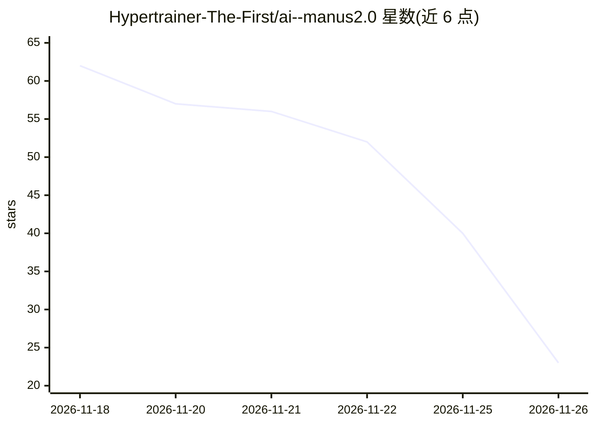

# Hypertrainer-The-First/ai--manus2.0

⭐ 23 · Apache-2.0 · 推送 2026-11-18 · [GitHub](https://github.com/Hypertrainer-The-First/ai--manus2.0) · 个人维护

**面向个人用户的自主 AI Agent：自动执行代码与浏览器任务**

README 将 Manus 描述为一个自主运行的 AI Agent：可自行编写并执行脚本、控制浏览器（打开网页、填写表单、读取信息），把用户描述的需求分解为多步骤操作并自动完成。定位为面向家庭、学习与轻量办公的小型任务助手，不面向企业级场景。提供桌面下载方式（附推广码），给出最低配置表（64 位系统、双核 CPU、4GB 内存），使用流程覆盖准备、配置、测试、自定义与日常应用。

## 筛选速览

| 维度 | 判定 | 备注 |
|---|---|---|
| AI 角色 | `ai-native` | 本体是模型或模型工具 |
| 许可风险 | `permissive` | Apache-2.0 |
| 部署形态 | `None` |  |
| 模型依赖 | — | README 未给出锁定关系 |
| 硬件要求 | — | 无带数字的原话,不猜 |
| 安装摩擦 | `low` | 无编译、无系统依赖或容器化 |
| 成熟度 | — | 结构信号不足 |

## 能力要点

- 自主代码执行：代理自行运行脚本完成任务
- 浏览器控制：导航网页、填写表单、收集信息
- 跨会话记住工作流模式并复用
- 提供最低硬件配置要求表与上手流程说明

## 适用场景

- 让学生代理整理研究笔记、跑小计算
- 远程工作者从多个网页收集数据
- 把重复的填表、查页面任务交给代理自动完成

## 场景标签

`聊天机器人` `编码 Agent` `浏览器自动化` · 领域:效率与自动化

## 证据(README 行号)

> L18: Manus is an autonomous AI agent designed to run code and control a browser on your behalf. Instead of acting like a
> L10: - **Autonomous Code Execution:** Manus AI agent runs code on its own to complete tasks, so you can focus on decisio
> L11: - **Browser Control Made Simple:** Manus browser control lets the agent navigate websites, fill forms, and gather i

## 星数曲线

2026-11-18 62 → 2026-11-26 23（-39）

---
*卡片 v1 · prompt 1.4 · 生成 2026-11-19 · 置信度 mid · 依据 README sha `d9b8fddd7ed2` · [字段定义](../../DATASET.md)*
