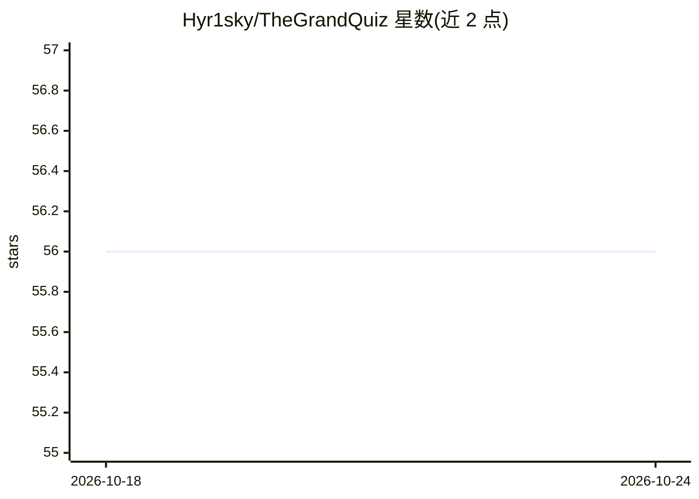

# Hyr1sky/TheGrandQuiz

⭐ 56 · Python · MIT · 推送 2026-09-16 · [GitHub](https://github.com/Hyr1sky/TheGrandQuiz) · 个人维护 · 中文 README

**考核驱动的本地个人学习 Agent：材料入库、对话、逐题考核与薄弱点复考**

面向学习者的 CLI 与 Local Web 应用：导入 Markdown/文本/URL 材料，经人工筛选入库后进行有证据的对话（exact scope，不静默扩到全库）与逐题考核，LLM 逐点评判、记录薄弱概念并在下一轮优先复考；支持 ASR 生成可编辑语音草稿。底层提供 Agent Runtime（事件驱动、Trace/Replay、有界重试）、Eval Harness 与 HITL 审批，数据存本机 SQLite。需 Python 3.12+ 与 OpenAI-compatible 或原生 Anthropic 服务；v0.5.0 为单用户本机版本，无账号/多用户/云同步，Web 仅监听 127.0.0.1。个人维护，自述早期版本。

## 筛选速览

| 维度 | 判定 | 备注 |
|---|---|---|
| AI 角色 | `ai-native` | 本体是模型或模型工具 |
| 许可风险 | `permissive` | MIT |
| 部署形态 | `library` | 以包/库形式分发 |
| 模型依赖 | — | README 未给出锁定关系 |
| 硬件要求 | — | 无带数字的原话,不猜 |
| 安装摩擦 | `low` | 无编译、无系统依赖或容器化 |
| 成熟度 | `idea` | |

## 能力要点

- 逐题考核暴露薄弱点，下一轮优先复考
- 对话/题目/判决可回溯到材料 Evidence（revision/node/span）
- ASR 语音转写先生成可编辑草稿再提交，原始音频不落盘
- Agent Runtime 提供 Trace/Replay、有界重试与 17 条离线 Eval

## 适用场景

- 把学习材料导入本机后边对话边考核，定位掌握不牢的概念
- 按主题搜索候选材料并人工审批后入库
- 用语音作答开放题并在提交前编辑转写草稿

## 场景标签

`RAG` `语音识别` · 领域:知识与检索

## 证据(README 行号)

> L25: TheGrandQuiz 是一个真实学习产品，也是 Agent 工程能力的完整竖切：学习者看到的是材料入库、对话、考核、
> L62: |**逐题考核**|选择题、开放问答、薄弱点复考；开放题可提交一次补充说明|LLM 逐点评判，代码聚合、记账并以追加事实修正状态|

## 星数曲线

2026-10-18 56 → 2026-10-24 56（+0）

---
*卡片 v1 · prompt 1.4 · 生成 2026-10-24 · 置信度 mid · 依据 README sha `457b4f2923ff` · [字段定义](../../DATASET.md)*
