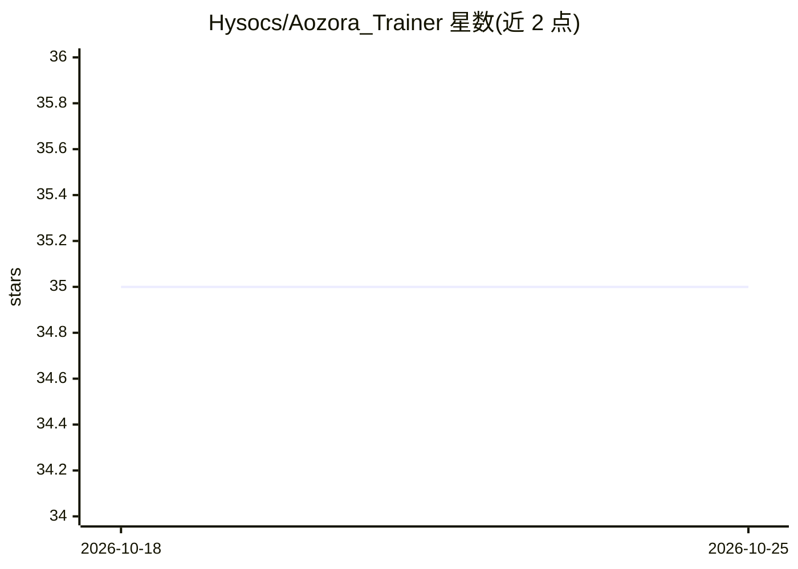

# Hysocs/Aozora_Trainer

⭐ 35 · Python · Apache-2.0 · 推送 2026-09-29 · [GitHub](https://github.com/Hysocs/Aozora_Trainer) · 个人维护

**面向 12GB 显卡消费级 GPU 的 SDXL/Anima 微调训练 GUI 工具**

基于 GUI 的模型微调训练器，支持 SDXL UNet（epsilon/v-prediction/rectified flow）与 Anima DiT 模型，面向希望在单张消费级 GPU 上做全模型训练的用户。通过 CPU 卸载优化器状态、混合精度、梯度检查点、潜变量与文本嵌入缓存等手段降低显存占用，测试中 SDXL 训练可在 11.80 GB 显存下保持 80-90% UNet 可训练。提供 Raven/Titan 两个自定义优化器、可视化学习率与 timestep 控制，支持 CLI 训练与断点续训。自述为 Beta 软件，未广泛测试；面向 Windows 10/11 环境。

## 筛选速览

| 维度 | 判定 | 备注 |
|---|---|---|
| AI 角色 | `ai-ecosystem` | LLM/agent 周边工具 |
| 许可风险 | `permissive` | Apache-2.0 |
| 部署形态 | `desktop` | 安装包/桌面程序 |
| 模型依赖 | — | README 未给出锁定关系 |
| 硬件要求 | `gpu-8g` | |
| 安装摩擦 | `medium` | 含编译或系统依赖之一 |
| 成熟度 | `idea` | |

## 能力要点

- SDXL 训练在 11.80 GB VRAM 下 80-90% UNet 可训练
- CPU 卸载优化器状态、梯度检查点、潜变量/嵌入缓存等低显存技术
- 自定义优化器 Raven（默认）与 Titan（进一步卸载梯度）
- 可视化 timestep 分配、loss 权重与学习率曲线控制

## 适用场景

- 在 12GB 显存的单张游戏显卡上全模型微调 SDXL 或 Anima DiT
- 通过 GUI 调整学习率、timestep 与层冻结等训练细节而不手写 JSON 配置
- 用小数据集试跑并对比 checkpoint 验证训练效果

## 场景标签

`微调` · 领域:训练与推理

## 证据(README 行号)

> L3: Aozora Trainer is a GUI-based model fine-tuning trainer focused on making full-model training practical on single co
> L5: It is built for users who want more control than a preset-only trainer, but do not want to manage large JSON configs
> L17: > Current testing shows SDXL training can run with **80-90% of the full UNet trainable** on **11.80 GB VRAM**, at r

## 星数曲线

2026-10-18 35 → 2026-10-25 35（+0）

---
*卡片 v1 · prompt 1.4 · 生成 2026-10-25 · 置信度 high · 依据 README sha `60cf42bcb394` · [字段定义](../../DATASET.md)*
