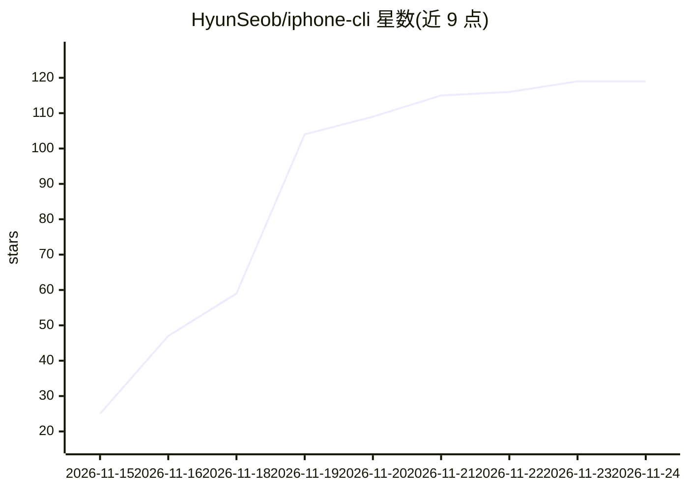

# HyunSeob/iphone-cli

⭐ 136 · Rust · MIT · 推送 2026-11-23 · [GitHub](https://github.com/HyunSeob/iphone-cli) · [官网](https://hyunseob.github.io/iphone-cli/) · 个人维护 · 中文 README

**让 AI agent 通过无障碍树读取并操作真机 iPhone 的 CLI/MCP 工具**

100% Rust 实现的单文件二进制，通过 USB 或 Wi-Fi 连接真机 iPhone（iOS 27+），读取结构化无障碍树而非截图，并执行点击、滑动、输入、启动应用等操作；内置 QuickJS 引擎支持多步脚本，提供 CLI、MCP 服务器与安全优先的三态结果（done/not_sent/unknown）。面向希望操控 iPhone 的 AI agent 与自动化开发者，无需 Xcode、WebDriverAgent 或 Appium 运行时。限制：仅支持真机（不支持模拟器/Android/Linux 主机），输入依赖 iOS 27 新增的屏幕共享服务，仅在少数设备上验证过。

## 筛选速览

| 维度 | 判定 | 备注 |
|---|---|---|
| AI 角色 | `ai-ecosystem` | LLM/agent 周边工具 |
| 许可风险 | `permissive` | MIT |
| 部署形态 | `desktop` | 安装包/桌面程序 |
| 模型依赖 | — | README 未给出锁定关系 |
| 硬件要求 | — | 无带数字的原话,不猜 |
| 安装摩擦 | `low` | 无编译、无系统依赖或容器化 |
| 成熟度 | — | 结构信号不足 |

## 能力要点

- 读取结构化无障碍树而非截图，支持选择器定位元素
- 内置 QuickJS 引擎，`iph script` 单次调用执行多步流程
- 提供 CLI 与 MCP 服务器（`iph mcp`），输出 JSON 与三态安全结果
- 单一原生二进制（macOS/Windows），无 Python/Node.js/Appium 依赖

## 适用场景

- 让 AI agent 通过 MCP 操控真机 iPhone 上的任意应用
- 在 CI 或终端中自动化 iOS 应用操作流程
- 以结构化无障碍树读取屏幕内容供 agent 决策

## 场景标签

`GUI 自动化` · 领域:效率与自动化

## 证据(README 行号)

> L3: **Let AI agents read and operate any app on a real iPhone — straight from your terminal.**
> L9: - **Agent-ready** — CLI + MCP server (`iph mcp`) + safety-first outcomes (`done` / `not_sent` / `unknown`)
> L131: |`iph mcp [--tools a,b]`|MCP server on stdio|

## 星数曲线

2026-11-15 25 → 2026-11-24 119（+94）

---
*卡片 v1 · prompt 1.4 · 生成 2026-11-18 · 置信度 high · 依据 README sha `d9eda985628c` · [字段定义](../../DATASET.md)*
