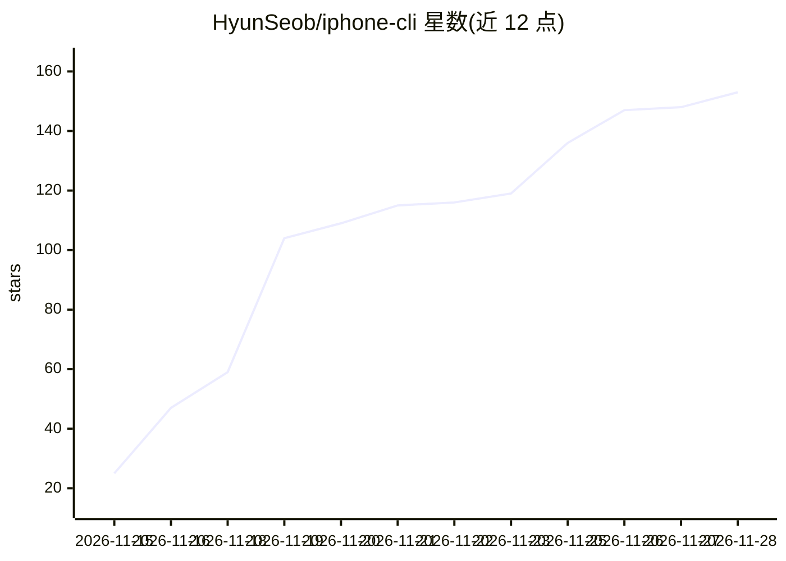

# HyunSeob/iphone-cli

⭐ 153 · Rust · MIT · 推送 2026-11-24 · [GitHub](https://github.com/HyunSeob/iphone-cli) · [官网](https://hyunseob.github.io/iphone-cli/) · 个人维护

**让 AI agent 通过无障碍树读取并操作真机 iPhone 的 CLI/MCP 工具**

用 Rust 编写的单一原生二进制工具（macOS 与 Windows 主机），通过 USB 或 Wi-Fi 连接 Apple 开发者服务，读取真机 iPhone 的无障碍树并执行点击、滑动、输入、启动应用、截屏录屏等操作，要求设备 iOS 27+。提供 CLI、内置 QuickJS 的多步脚本引擎、MCP 服务器（iph mcp），操作结果带 done/not_sent/unknown 安全性契约。无需 Xcode、签名或在手机上安装应用；Linux 主机、模拟器、Android、横屏不在范围内，验证仅限一台 iPhone 15 Pro Max。

## 筛选速览

| 维度 | 判定 | 备注 |
|---|---|---|
| AI 角色 | `ai-ecosystem` | LLM/agent 周边工具 |
| 许可风险 | `permissive` | MIT |
| 部署形态 | `desktop` | 安装包/桌面程序 |
| 模型依赖 | — | README 未给出锁定关系 |
| 硬件要求 | — | 无带数字的原话,不猜 |
| 安装摩擦 | `medium` | 含编译或系统依赖之一 |
| 成熟度 | `idea` | |

## 能力要点

- 直接连接 Apple 无障碍与 HID 服务，无需 Xcode、签名或 WebDriverAgent
- 读取结构化无障碍树而非截图，内置 QuickJS 引擎单次调用执行多步流程
- 提供 MCP 服务器（iph mcp）与 done/not_sent/unknown 结果契约
- iph doctor/setup 提供配对、开发者模式、磁盘镜像等自检与修复流程

## 适用场景

- 让 Claude Code 或其他 AI agent 自动操作真机 iPhone 上的应用
- 在 Windows 主机上通过 USB/Wi-Fi 驱动 iPhone 做自动化测试
- 批量执行 JSON 步骤或 JavaScript 脚本完成多步 UI 流程

## 场景标签

`GUI 自动化` · 领域:效率与自动化

## 证据(README 行号)

> L3: **Let AI agents read and operate any app on a real iPhone — straight from your terminal.**
> L9: - **Agent-ready** — CLI + MCP server (`iph mcp`) + safety-first outcomes (`done` / `not_sent` / `unknown`)
> L50: - **Choose `iphone-cli` (`iph`)** when you want Claude Code, Codex, or another AI agent to operate a **real iPhone 

## 星数曲线

2026-11-15 25 → 2026-11-28 153（+128）

---
*卡片 v1 · prompt 1.4 · 生成 2026-11-27 · 置信度 high · 依据 README sha `936e01b944e0` · [字段定义](../../DATASET.md)*
