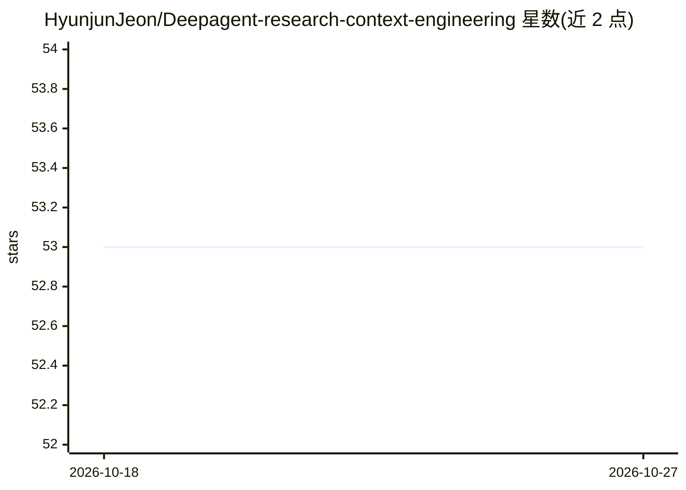

# HyunjunJeon/Deepagent-research-context-engineering

⭐ 53 · Python · MIT · 推送 2026-01-13 · [GitHub](https://github.com/HyunjunJeon/Deepagent-research-context-engineering) · 个人维护

**基于 DeepAgents 的研究用多智能体系统，文件系统式上下文工程**

使用 LangChain 的 deepagents 库构建的研究（Research）多智能体系统：主编排 DeepAgent 通过委托策略调度自主研究的子智能体，采用“广度探索→深度挖掘”的研究工作流；上下文管理基于文件系统，research_workspace 作为智能体的永久文件存储，skills 目录以 YAML front-matter 的 SKILL.md 定义技能，并附带 LangChain 提供的 deep-agents-ui 可视化界面（需另行 clone 并以 yarn 运行）。README 为韩文，以项目结构与文件说明为主，未给出本仓库自身的安装命令。

## 筛选速览

| 维度 | 判定 | 备注 |
|---|---|---|
| AI 角色 | `ai-native` | 本体是模型或模型工具 |
| 许可风险 | `permissive` | MIT |
| 部署形态 | `library` | 以包/库形式分发 |
| 模型依赖 | — | README 未给出锁定关系 |
| 硬件要求 | — | 无带数字的原话,不猜 |
| 安装摩擦 | `low` | 无编译、无系统依赖或容器化 |
| 成熟度 | — | 结构信号不足 |

## 能力要点

- DeepAgent 主编排器 + Simple SubAgent 的多智能体研究架构
- research_workspace 文件系统作为智能体永久上下文存储
- YAML front-matter 的 SKILL.md 技能定义
- 子智能体采用“广度探索→深度挖掘”研究工作流

## 适用场景

- 搭建自动化研究的 DeepAgent 多智能体系统
- 参考基于文件系统的上下文工程（Context Engineering）实现
- 借助 DeepAgent UI 可视化观察智能体研究过程

## 场景标签

`多智能体` `科研工具` · 领域:Agent 开发

## 证据(README 行号)

> L3: Agent 2.0 Paradigm 을 잘 구현하는 DeepAgent 를 활용해서, FileSystem 기반 Context Engineering 을 원활히 수행하는 Research 용 Multi Agent 구성
> L47: |`researcher/agent.py`|자율적으로 연구하게끔 구성된 에이전트|
> L48: |`researcher/prompts.py`|"넓게 탐색 → 깊게 파기" 전략으로 구성된 워크플로우 정의|

## 星数曲线

2026-10-18 53 → 2026-10-27 53（+0）

---
*卡片 v1 · prompt 1.4 · 生成 2026-10-24 · 置信度 low · 依据 README sha `3d466e56e27a` · [字段定义](../../DATASET.md)*
