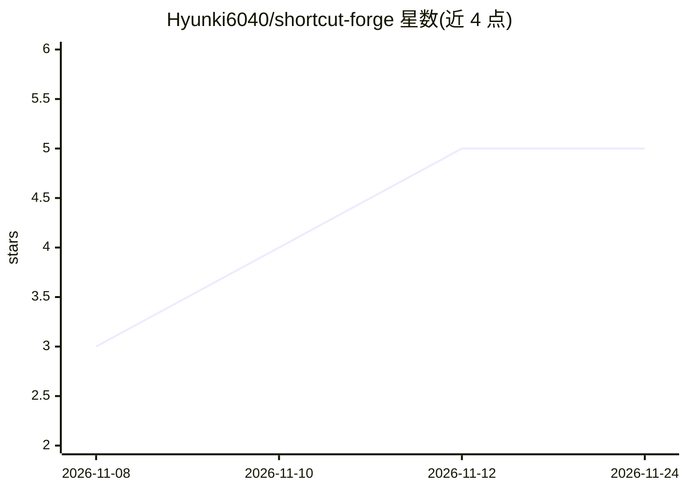

# Hyunki6040/shortcut-forge

⭐ 5 · Python · MIT · 推送 2026-10-14 · [GitHub](https://github.com/Hyunki6040/shortcut-forge) · [官网](https://github.com/Hyunki6040/shortcut-forge) · 个人维护 · 中文 README

**AI 生成 iOS 快捷指令的 MCP server：构建、校验并签名 .shortcut 文件**

MCP server、Claude 插件与 Python 库三形态：将自然语言描述转为可签名的 JSON spec，经 15 条语义 lint 规则（SF000–SF014）检查后，在 macOS 上自动签名生成 .shortcut 文件，供 iPhone 导入。提供 20+ 条目的开源快捷指令库、模板与 watch-folder 签名代理；签名依赖 Mac（Apple 规则），Stored Content 等操作需 iOS 27。

## 筛选速览

| 维度 | 判定 | 备注 |
|---|---|---|
| AI 角色 | `ai-ecosystem` | LLM/agent 周边工具 |
| 许可风险 | `permissive` | MIT |
| 部署形态 | `library` | 以包/库形式分发 |
| 模型依赖 | — | README 未给出锁定关系 |
| 硬件要求 | — | 无带数字的原话,不猜 |
| 安装摩擦 | `low` | 无编译、无系统依赖或容器化 |
| 成熟度 | — | 结构信号不足 |

## 能力要点

- JSON spec → lint → macOS 自动签名 → .shortcut 的完整构建链
- 15 条针对真机失败模式的语义 lint 规则（SF000–SF014）
- 20+ 社区快捷指令开源库与多用户模板
- watch-folder 签名代理：任何设备/AI 写入 JSON 即出签名文件

## 适用场景

- 用已有的 AI 客户端生成可导入 iPhone 的快捷指令
- 诊断从快捷指令 App 导出的 .shortcut 文件崩溃原因
- 通过 iCloud Drive 实现手机上让 ChatGPT 生成快捷指令并当天签名使用

## 场景标签

`代码生成` · 领域:编码与开发

## 证据(README 行号)

> L42: **shortcut-forge** is an MCP server, a Claude plugin and a Python library that turns *"make me a shortcut that…"*
> L76: { "mcpServers": { "shortcut-forge": { "command": "uvx", "args": ["shortcut-forge", "mcp"] } } }

## 星数曲线

2026-11-08 3 → 2026-11-24 5（+2）

---
*卡片 v1 · prompt 1.4 · 生成 2026-11-21 · 置信度 high · 依据 README sha `a5870cf9da80` · [字段定义](../../DATASET.md)*
