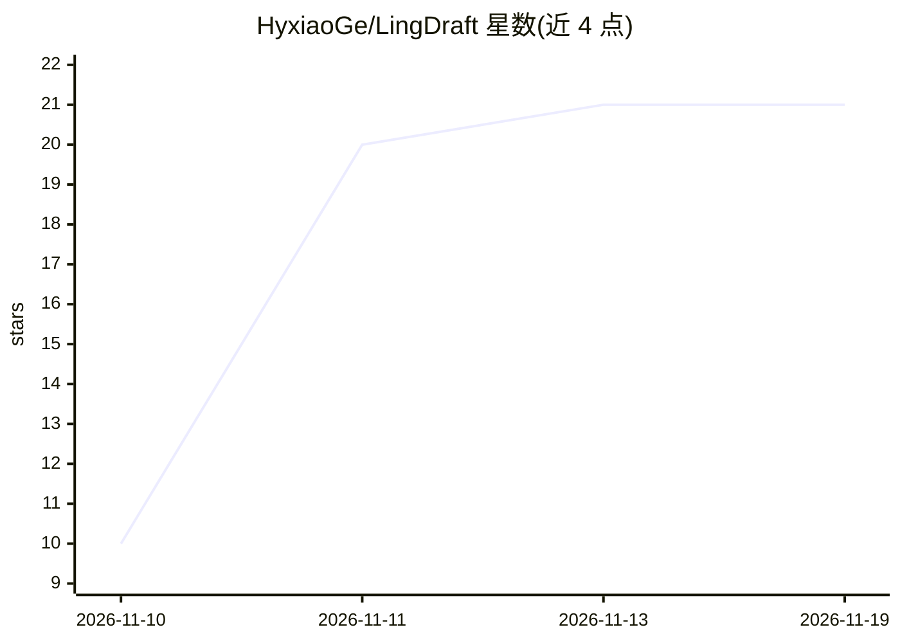

# HyxiaoGe/LingDraft

⭐ 21 · Python · 推送 2026-11-13 · [GitHub](https://github.com/HyxiaoGe/LingDraft) · [官网](https://lingdraft.seanfield.org) · 个人维护 · 中文 README

**面向用户的 AI 对话 agent：搜索、读文件、标来源、写成文档出版本**

灵稿是一个自托管的 AI 对话 agent 应用：主 agent 与并行子 agent 均基于 LangChain create_agent 加 16 个自写中间件，支持搜索与读网页（MCP 工具）、看图、查用户资料库（pgvector + RRF + 重排）、把文档/网页/代码写成文件并按版本管理，能通过 interrupt 停下来问用户，支持定时任务与长期记忆。运行层自写，处理排队、插话、停止、断线续看；默认 DeepSeek，另直连 7 家模型并按免费额度路由。需自行部署，依赖 Postgres，通过 Docker Compose 提供。

## 筛选速览

| 维度 | 判定 | 备注 |
|---|---|---|
| AI 角色 | `ai-native` | 本体是模型或模型工具 |
| 许可风险 | `none` | — |
| 部署形态 | `self-host` | docker 或自建部署 |
| 模型依赖 | locked-api |  |
| 硬件要求 | — | 无带数字的原话,不猜 |
| 安装摩擦 | `low` | 无编译、无系统依赖或容器化 |
| 成熟度 | — | 结构信号不足 |

## 能力要点

- create_agent + 16 个自写中间件，子 agent 并行（每轮最多 5 个、同时 3 个）
- 围着前缀缓存的上下文压缩与检查点裁剪（durability=exit + keep_latest）
- 资料库检索：pgvector 向量 + 关键词 RRF 合并 + 重排取前 8 块，引用标到段落
- gVisor 容器沙箱跑命令，文档版本表 + convert-doc 导出 PDF/Word/PPT

## 适用场景

- 让 agent 搜资料并产出标注来源的对比报告或方案文档
- 上传自己的文件建资料库，回答引用可点开看到原文段落
- 设定定时任务（如每日 AI 新闻简报）自动在对话中产出内容
- 安排出行：查天气、路线、火车班次并生成卡片

## 场景标签

`AI 助手` `文档问答` `AI 写作` · 领域:对话与助手

## 证据(README 行号)

> L5: 一个能搜、能读、回答会标来源的 AI 对话 agent。能看用户发的图和文件，能查用户自己的资料库；用户要成品时，把文档、网页、代码写成文件，右栏边写边看，改一次出一版。做到一半碰到只有用户能定的地方，会停下来问，等回答了接着做。还
> L137: - 模型：默认 DeepSeek V4 Pro（主 agent、整理记忆）、Flash（子 agent、判断难易、起标题、写短版）；输入框旁边还能选豆包、Kimi、千问、MiMo、GLM、混元、MiniMax；资料库用千问 qw

## 星数曲线

2026-11-10 10 → 2026-11-19 21（+11）

---
*卡片 v1 · prompt 1.4 · 生成 2026-11-18 · 置信度 high · 依据 README sha `3a3c60190898` · [字段定义](../../DATASET.md)*
