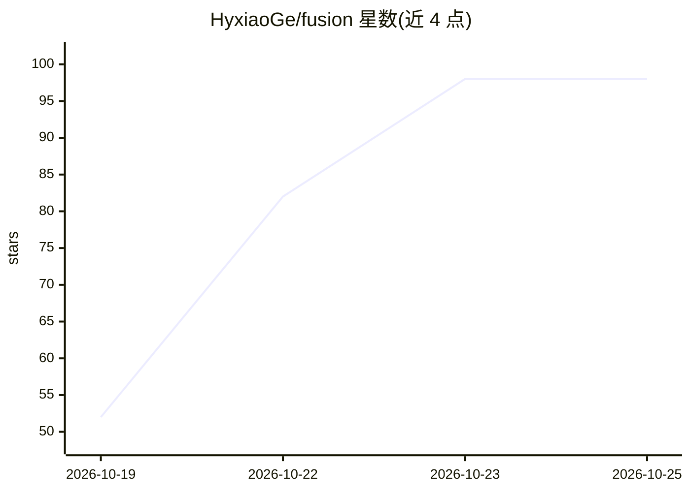

# HyxiaoGe/fusion

⭐ 98 · Python · 推送 2026-10-24 · [GitHub](https://github.com/HyxiaoGe/fusion) · [官网](https://fusion.seanfield.org/) · 个人维护 · 中文 README

**面向任务执行的 AI 聊天工作台：单 Agent 循环、有据可查**

面向终端用户的 AI 聊天产品，用户提问后由单 Agent 循环自行决定查什么、做什么：联网回答分「已使用/候选/已深读」三层来源并可按引用编号定位，能生成带版本记录的交付物文档（Markdown/HTML），提供按时间线还原模型请求、工具调用与耗时的轨迹视图。能力覆盖网页搜索与深读、和风天气、路线/航班/高铁查询、个人知识库（向量检索）、MCP 接入与 AI 生图，模型经 LiteLLM 统一接入。前后端约各 6.7 万行代码，本地开发需自备 PostgreSQL、Redis、Auth Service、LiteLLM 等外部依赖，不提供一键启动脚本。

## 筛选速览

| 维度 | 判定 | 备注 |
|---|---|---|
| AI 角色 | `ai-native` | 本体是模型或模型工具 |
| 许可风险 | `none` | — |
| 部署形态 | `None` |  |
| 模型依赖 | — | README 未给出锁定关系 |
| 硬件要求 | — | 无带数字的原话,不猜 |
| 安装摩擦 | `low` | 无编译、无系统依赖或容器化 |
| 成熟度 | — | 结构信号不足 |

## 能力要点

- 单 Agent 循环：不预判意图，模型自行选择工具，受超时/步数/调用次数三重上限约束
- 回答来源三层分类（已使用/候选/已深读），引用编号可定位
- 可审计运行轨迹：统一 run_id、事件序号加锁递增、结束完整性校验
- 模型输出写 Redis Streams，支持断线续读与服务端继续执行

## 适用场景

- 问复杂问题并要求答案带可核查的来源引用
- 让 Agent 生成可交付的文档并持续修改出新版本
- 查看 Agent 每一步的工具调用与上下文用量过程

## 场景标签

`聊天机器人` `文档问答` · 领域:对话与助手

## 证据(README 行号)

> L3: > 面向任务执行的 AI 工作台：一个 Agent 循环，模型自己决定查什么、读什么、做什么，每一步都有据可查。
> L12: 问「北京未来三天天气怎么样，周末适合去爬长城吗？」，Agent 先查和风天气拿到四天预报；发现预报不覆盖周末，再搜索并深读中央气象台和中国气象局的页面补齐，最后给出带引用的结论。整个过程没有预设流程，由模型按结果决定下一步。
> L20: 联网回答把来源分成「已使用」「候选」和「已深读」三层，正文里的引用编号可以直接定位到对应来源。用户能看清答案用了哪些材料，以及哪些材料看过但没采用。

## 星数曲线

2026-10-19 52 → 2026-10-25 98（+46）

---
*卡片 v1 · prompt 1.4 · 生成 2026-10-23 · 置信度 mid · 依据 README sha `67a6317ddb2c` · [字段定义](../../DATASET.md)*
