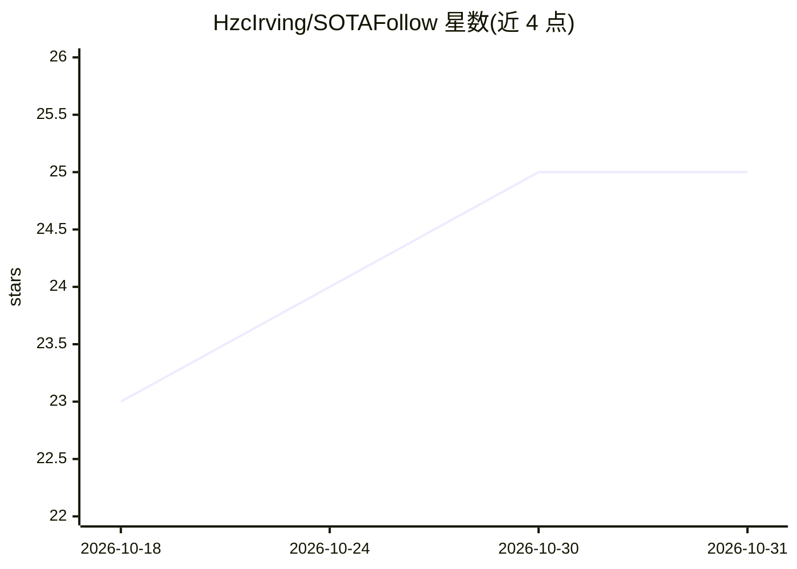

# HzcIrving/SOTAFollow

⭐ 25 · Python · 推送 2026-06-03 · [GitHub](https://github.com/HzcIrving/SOTAFollow) · 个人维护 · 中文 README

**AI/机器人前沿论文追踪笔记库：VLA、世界模型、RL、LLM 分类精读**

个人维护的 AI/机器人前沿论文分类笔记库：按 VLA、WorldModel、RL、LLM、基础模型知识、面试知识点、DailyAgent 等板块组织，收录论文条目附核心贡献摘要与精读文档链接，覆盖 Tokenizer、注意力、LoRA、位置编码、世界模型 Loss 等基础模块详解，含逐行代码级模型拆解系列与按天聚合的更新日志。内容以飞书/文档链接形式组织，不提供代码安装或运行方式。

## 筛选速览

| 维度 | 判定 | 备注 |
|---|---|---|
| AI 角色 | `ai-knowledge` | 知识聚合/清单类 |
| 许可风险 | `none` | — |
| 部署形态 | `None` |  |
| 模型依赖 | — | README 未给出锁定关系 |
| 硬件要求 | — | 无带数字的原话,不猜 |
| 安装摩擦 | `low` | 无编译、无系统依赖或容器化 |
| 成熟度 | — | 结构信号不足 |

## 能力要点

- VLA/WorldModel/RL/LLM 等板块的论文条目含核心贡献摘要与精读链接
- 基础模型知识模块覆盖 Tokenizer、注意力、微调、位置编码等详解
- 面试知识点分类整理（RL/LLM/VLA/WM）
- 按天聚合的更新日志与月度总结

## 适用场景

- 追踪 VLA、世界模型、强化学习领域的 SOTA 论文
- 系统学习基础模型底层机制（Tokenizer、注意力、LoRA 等）
- 准备 RL/LLM/VLA 相关面试的知识点查阅

## 场景标签

`精选清单` `教程课程` · 领域:学习与行业

## 证据(README 行号)

> L3: > 分类管理 SOTA（State-of-the-Art）论文，覆盖 VLA、WorldModel、RL、LLM 等领域
> L11: ## 🤖 VLA

## 星数曲线

2026-10-18 23 → 2026-10-31 25（+2）

---
*卡片 v1 · prompt 1.4 · 生成 2026-10-27 · 置信度 high · 依据 README sha `1a76b806d582` · [字段定义](../../DATASET.md)*
