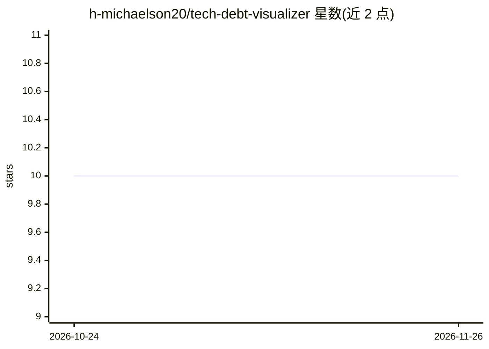

# h-michaelson20/tech-debt-visualizer

⭐ 10 · TypeScript · NOASSERTION · 推送 2026-02-19 · [GitHub](https://github.com/h-michaelson20/tech-debt-visualizer) · 个人维护

**终端代码库技术债分析工具：评分、热点与可选 AI 洞察**

npm 发布的 CLI 工具：遍历仓库源文件，用 tree-sitter 解析 JavaScript/TypeScript 与 Python，统计圈复杂度、文档覆盖、TODO/FIXME 标记，结合 git log 计算 churn 与热点评分，输出 0-100 债务分与 1-5 清洁度等级。可选接入 LLM（设置 API key 时）生成逐文件评估、债务项解释与重构建议；无 key 时 --no-llm 仅输出指标。结果可输出为终端、HTML（treemap/趋势图）、JSON 或 Markdown，支持 CI 模式，需 Node 18+。

## 筛选速览

| 维度 | 判定 | 备注 |
|---|---|---|
| AI 角色 | `ai-enhanced` | 去掉 AI 部分产品仍成立 |
| 许可风险 | `none` | NOASSERTION |
| 部署形态 | `library` | 以包/库形式分发 |
| 模型依赖 | locked-api |  |
| 硬件要求 | — | 无带数字的原话,不猜 |
| 安装摩擦 | `low` | 无编译、无系统依赖或容器化 |
| 成熟度 | — | 结构信号不足 |

## 能力要点

- tree-sitter 解析的多语言债务项检测（复杂度/文档/大文件/TODO 标记）
- git churn + 复杂度组合的热点评分与债务趋势
- 可选 LLM 逐文件评估、债务项解释与重构代码块
- CLI/HTML/JSON/Markdown 四种输出与 CI 退出码模式

## 适用场景

- 交付前扫描仓库获得债务评分与热点清单
- 在 CI 中按债务阈值让构建失败
- 让 LLM 针对债务项给出具体重构代码

## 场景标签

`代码审查` · 领域:编码与开发

## 证据(README 行号)

> L5: Analyze a repo and get a **cleanliness score**, **debt breakdown**, and optional **AI explanations and refactor sugg
> L59:  Pluggable analyzers (today: JavaScript/TypeScript and Python) parse each file with **tree-sitter**, then:
> L72: 5. **Optional LLM pass**

## 星数曲线

2026-10-24 10 → 2026-11-26 10（+0）

---
*卡片 v1 · prompt 1.4 · 生成 2026-11-19 · 置信度 high · 依据 README sha `3963f7bcff3e` · [字段定义](../../DATASET.md)*
