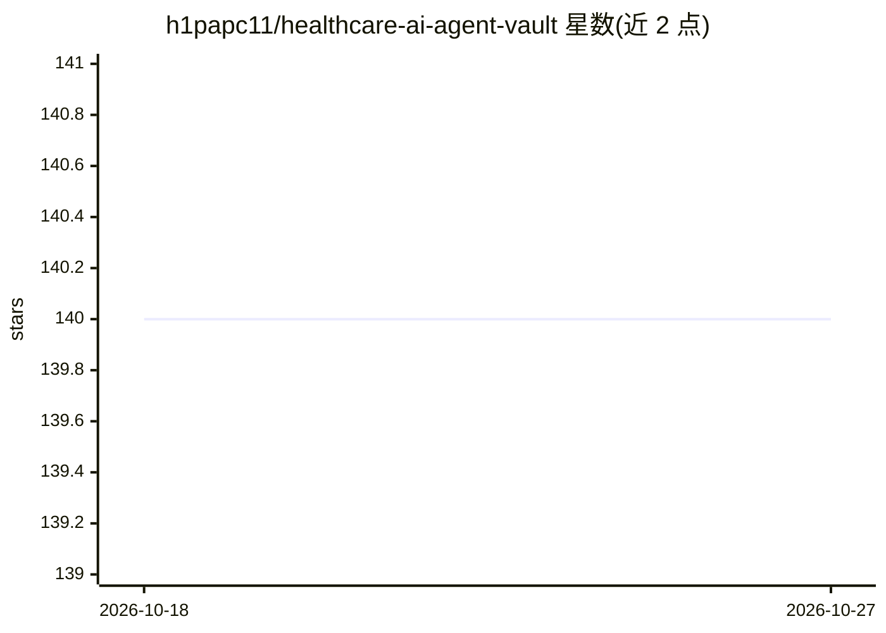

# h1papc11/healthcare-ai-agent-vault

⭐ 140 · TypeScript · MIT · 推送 2026-09-14 · [GitHub](https://github.com/h1papc11/healthcare-ai-agent-vault) · 个人维护 · 中文 README

**家庭健康档案库：Obsidian 模板+AI 提示词+Apple Health 预处理**

本地优先的家庭健康档案仓库，由三部分组成：Obsidian vault 模板（中心页、成员档案、追踪 CSV 与字段标准）、八个 AI 提示词工作流及配套 Claude Code 技能（体检报告提取、药物识别、趋势分析、就诊准备等），以及一个 TypeScript 流式预处理 CLI，将 Apple Health 的 XML/ZIP 导出拆分为带类型的 CSV（心率、睡眠、锻炼等 9 类）。数据保留在本机，AI 仅在用户主动调用时参与。需 Node.js 20+，Redis 缓存可选，MIT 许可。

## 筛选速览

| 维度 | 判定 | 备注 |
|---|---|---|
| AI 角色 | `ai-enhanced` | 去掉 AI 部分产品仍成立 |
| 许可风险 | `permissive` | MIT |
| 部署形态 | `library` | 以包/库形式分发 |
| 模型依赖 | — | README 未给出锁定关系 |
| 硬件要求 | — | 无带数字的原话,不猜 |
| 安装摩擦 | `low` | 无编译、无系统依赖或容器化 |
| 成熟度 | — | 结构信号不足 |

## 能力要点

- Obsidian vault 模板与中文知识库字段标准
- 8 个 AI 提示词工作流与对应的 Claude Code 技能
- TypeScript 流式解析 Apple Health XML/ZIP 导出为类型化 CSV（9 种输出类型）
- 可选 Redis 导出任务缓存与完整的 build/lint/test 流水线

## 适用场景

- 把家人的体检报告、药物照片和可穿戴数据统一整理成本地档案
- 用 AI 工具按工作流从照片和 PDF 提取结构化健康记录
- 将 Apple Health 大导出文件拆分为可分析的 CSV

## 场景标签

`提示工程` `知识库管理` · 领域:Agent 开发

## 证据(README 行号)

> L3: A local-first family health archive that combines Obsidian templates, AI prompt workflows, and a TypeScript preproce
> L5: Your health data stays on your machine. AI assists with structuring and analysis — you control what leaves your devi
> L213: Only if you paste it into a cloud AI service. The vault itself is local Markdown and CSV.

## 星数曲线

2026-10-18 140 → 2026-10-27 140（+0）

---
*卡片 v1 · prompt 1.4 · 生成 2026-10-22 · 置信度 high · 依据 README sha `02330904281f` · [字段定义](../../DATASET.md)*
