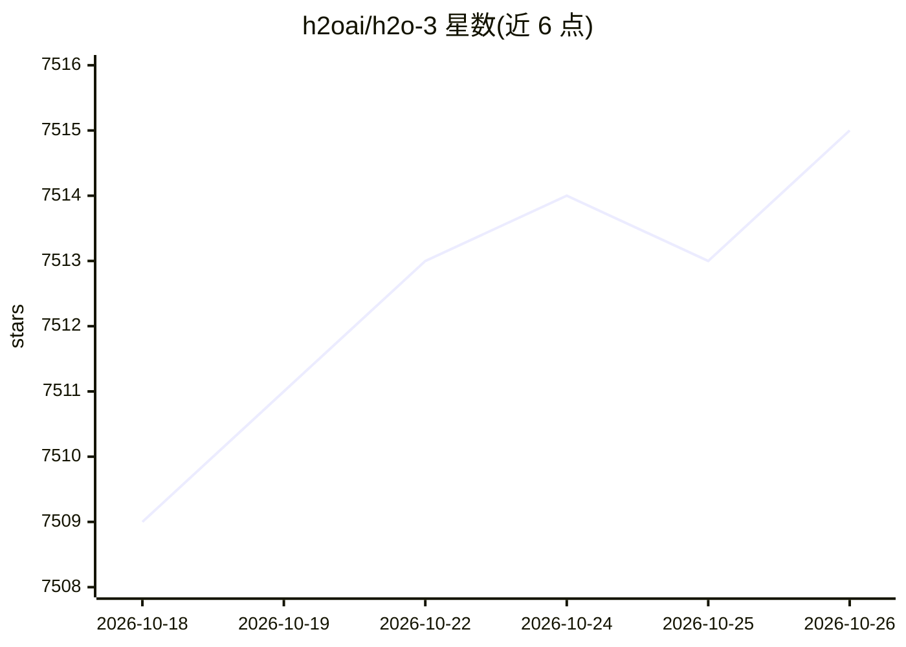

# h2oai/h2o-3

⭐ 7,515 · Jupyter Notebook · Apache-2.0 · 推送 2026-10-22 · [GitHub](https://github.com/h2oai/h2o-3) · [官网](http://h2o.ai) · 组织维护

**分布式内存机器学习平台，供数据科学家用多语言接口建模**

H2O-3 是内存型分布式机器学习平台，提供 GLM、GBM（含 XGBoost）、随机森林、深度神经网络、堆叠集成、Word2Vec 等算法实现及 H2O AutoML 自动建模。用户通过 R、Python、Scala、Java、JSON 与 Flow notebook 接口交互，可与 Hadoop、Spark 配合。模型可导出为 POJO/MOJO 用于生产评分。多数用户经 PyPI/CRAN 安装预构建包；从源码构建需 JDK 1.8+、Node.js、Python、R 与 Gradle。

## 筛选速览

| 维度 | 判定 | 备注 |
|---|---|---|
| AI 角色 | `ai-native` | 本体是模型或模型工具 |
| 许可风险 | `permissive` | Apache-2.0 |
| 部署形态 | `desktop` | 安装包/桌面程序 |
| 模型依赖 | — | README 未给出锁定关系 |
| 硬件要求 | — | 无带数字的原话,不猜 |
| 安装摩擦 | `medium` | 含编译或系统依赖之一 |
| 成熟度 | — | 结构信号不足 |

## 能力要点

- 内存型分布式架构，支持 Hadoop/Spark 大数据环境
- 多算法实现：GLM/GBM/随机森林/深度学习/堆叠集成等
- H2O AutoML 全自动机器学习算法
- 模型可导出 POJO/MOJO 用于生产评分

## 适用场景

- 用 Python 或 R 进行分布式机器学习建模
- 在 Hadoop/Spark 集群上运行大规模模型训练
- 用 AutoML 自动搜索最优模型并导出部署

## 场景标签

 · 领域:机器学习/数据科学

## 证据(README 行号)

> L9: H2O is an in-memory platform for distributed, scalable machine learning. H2O uses familiar interfaces like R, Python
> L11: H2O is extensible so that developers can add data transformations and custom algorithms of their choice and access 

## 星数曲线

2026-10-18 7,509 → 2026-10-26 7,515（+6）

---
*卡片 v1 · prompt 1.4 · 生成 2026-10-20 · 置信度 high · 依据 README sha `1253be02ad81` · [字段定义](../../DATASET.md)*
