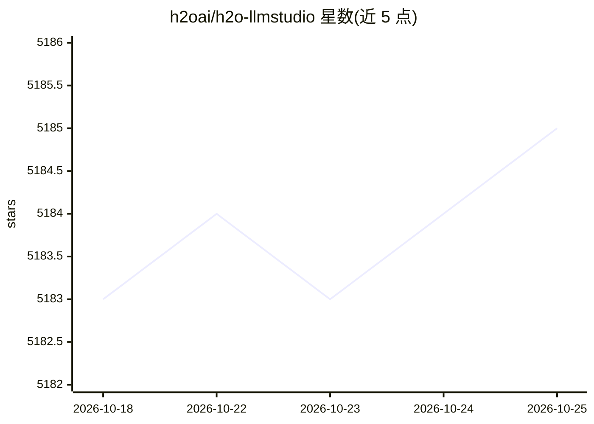

# h2oai/h2o-llmstudio

⭐ 5,186 · Python · Apache-2.0 · 推送 2026-10-24 · [GitHub](https://github.com/h2oai/h2o-llmstudio) · [官网](https://h2o.ai) · 组织维护

**无代码 GUI 与 CLI 的 LLM 微调框架**

由 H2O.ai 维护的 LLM 微调框架，提供图形界面与命令行两种使用方式：用户上传数据集后创建实验，通过界面配置超参数进行微调，支持 LoRA、8-bit 低显存训练与实验性 RL 微调，可对比实验、与模型对话并导出到 Hugging Face Hub。运行要求 Ubuntu 16.04+ 与至少一块 NVIDIA GPU（驱动 >=580），大模型建议 24GB 以上 GPU 显存。推荐以 uv + Python 3.10 安装，也提供 Docker 镜像与 runpod/Colab 运行途径。

## 筛选速览

| 维度 | 判定 | 备注 |
|---|---|---|
| AI 角色 | `ai-ecosystem` | LLM/agent 周边工具 |
| 许可风险 | `permissive` | Apache-2.0 |
| 部署形态 | `None` |  |
| 模型依赖 | — | README 未给出锁定关系 |
| 硬件要求 | — | 无带数字的原话,不猜 |
| 安装摩擦 | `medium` | 含编译或系统依赖之一 |
| 成熟度 | — | 结构信号不足 |

## 能力要点

- 无需编码经验的 GUI 微调界面，同时提供 CLI（yaml 配置）
- 支持 LoRA、8-bit 低显存训练与实验性 RL 微调
- 实验跟踪对比、W&B 集成、与训练模型交互对话
- 一键导出/发布模型到 Hugging Face Hub

## 适用场景

- 通过 GUI 无代码微调开源大语言模型
- 用 yaml 配置在单机/多 GPU（DDP）上批量微调实验
- 微调后与模型对话验证效果并发布到 Hugging Face

## 场景标签

`微调` · 领域:训练与推理

## 证据(README 行号)

> L1: Welcome to H2O LLM Studio, a framework and no-code GUI designed for
> L12: - easily and effectively fine-tune LLMs **without the need for any coding experience**.

## 星数曲线

2026-10-18 5,183 → 2026-10-25 5,185（+2）

---
*卡片 v1 · prompt 1.4 · 生成 2026-10-20 · 置信度 high · 依据 README sha `1fb854a28ee3` · [字段定义](../../DATASET.md)*
