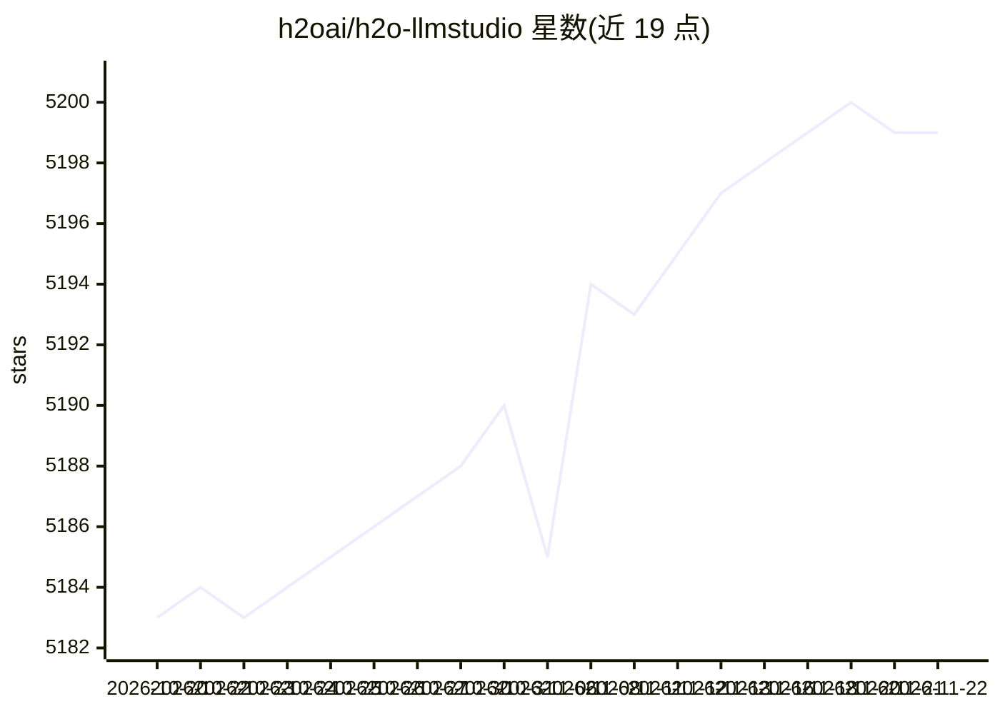

# h2oai/h2o-llmstudio

⭐ 5,199 · Python · Apache-2.0 · 推送 2026-11-19 · [GitHub](https://github.com/h2oai/h2o-llmstudio) · [官网](https://h2o.ai) · 组织维护

**面向微调 LLM 的无代码 GUI 框架**

H2O LLM Studio 是一个用于微调大语言模型的框架，提供无需编码经验的图形界面，也支持 CLI 通过 yaml 配置运行实验。支持 LoRA、8-bit 训练、强化学习微调（实验性）、模型评估指标与性能可视化对比，可导出模型到 Hugging Face Hub。运行依赖 Ubuntu 16.04+ 与 NVIDIA GPU（建议 24GB 显存），通过 uv/make 或 Docker 部署，GUI 基于 H2O Wave 服务器，多 GPU 支持 DDP 模式。

## 筛选速览

| 维度 | 判定 | 备注 |
|---|---|---|
| AI 角色 | `ai-ecosystem` | LLM/agent 周边工具 |
| 许可风险 | `permissive` | Apache-2.0 |
| 部署形态 | `None` |  |
| 模型依赖 | — | README 未给出锁定关系 |
| 硬件要求 | — | 无带数字的原话,不猜 |
| 安装摩擦 | `medium` | 含编译或系统依赖之一 |
| 成熟度 | — | 结构信号不足 |

## 能力要点

- 无代码 GUI 与 CLI 双模式微调 LLM
- 支持 LoRA、8-bit 训练与 RL 微调（实验性）
- 多 GPU DDP 训练与实验监控对比
- 导出模型到 Hugging Face Hub

## 适用场景

- 不用写代码就对自有数据微调 LLM
- 比较不同微调实验的评估指标与性能
- 把微调后的模型发布到 Hugging Face 分享

## 场景标签

`微调` `强化学习` · 领域:训练与推理

## 证据(README 行号)

> L1: Welcome to H2O LLM Studio, a framework and no-code GUI designed for
> L12: - easily and effectively fine-tune LLMs **without the need for any coding experience**.
> L38: H2O LLM Studio requires a machine with Ubuntu 16.04+ and at least one recent NVIDIA GPU with NVIDIA drivers version

## 星数曲线

2026-10-20 5,183 → 2026-11-22 5,199（+16）

---
*卡片 v1 · prompt 1.4 · 生成 2026-11-22 · 置信度 high · 依据 README sha `a7a956ad234f` · [字段定义](../../DATASET.md)*
