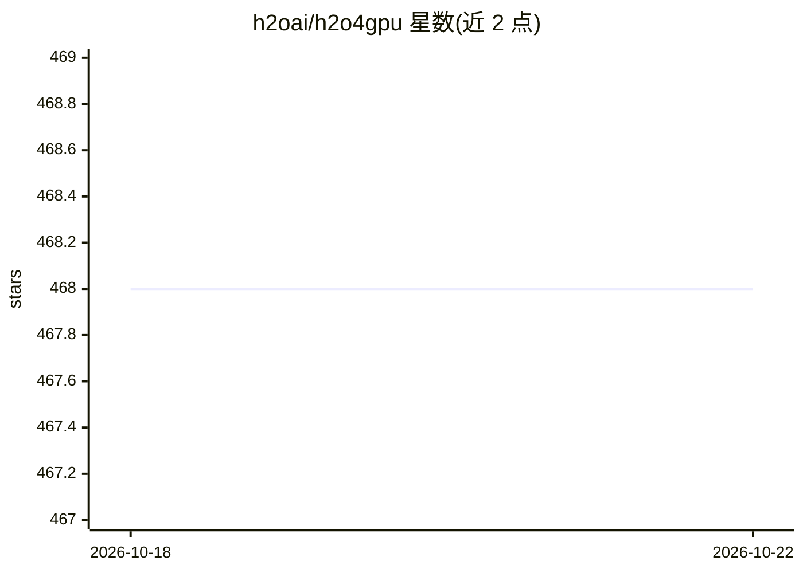

# h2oai/h2o4gpu

⭐ 468 · C++ · Apache-2.0 · 推送 2026-10-20 · [GitHub](https://github.com/h2oai/h2o4gpu) · 组织维护

**H2O.ai 的 GPU 机器学习求解器库，可替换 scikit-learn**

H2O4GPU 是 H2O.ai 维护的 GPU 求解器集合，提供 Python 与 R 两种 API。Python API 构建 在 scikit-learn 之上，可通过 `import h2o4gpu as sklearn` 作为 drop-in replacement 使用：继承 scikit-learn 全部 CPU 算法，在不支持某些参数时回退到 CPU 实现。R 包是 Python 包的封装。求解器覆盖 GLM（Lasso/Ridge/逻辑回归/Elastic Net）、KMeans、基于 XGBoost 的 GBM、SVD/PCA。要求 Linux、CUDA 8-10、NVIDIA GPU（计算能力 ≥3.5），提供 wheel、conda 与 nvidia-docker 镜像三种安装途径。

## 筛选速览

| 维度 | 判定 | 备注 |
|---|---|---|
| AI 角色 | `ai-native` | 本体是模型或模型工具 |
| 许可风险 | `permissive` | Apache-2.0 |
| 部署形态 | `self-host` | docker 或自建部署 |
| 模型依赖 | — | README 未给出锁定关系 |
| 硬件要求 | — | 无带数字的原话,不猜 |
| 安装摩擦 | `low` | 无编译、无系统依赖或容器化 |
| 成熟度 | — | 结构信号不足 |

## 能力要点

- 可作为 scikit-learn 的 drop-in replacement（import h2o4gpu as sklearn）
- GPU 加速的 GLM/KMeans/GBM(XGBoost)/SVD/PCA 求解器，不支持时自动回退 CPU
- 同时提供 Python 与 R 接口（R 包封装 Python 包）
- 提供预编译 nvidia-docker 运行时镜像，内含 Jupyter 演示

## 适用场景

- 在已有 scikit-learn 代码中引入 GPU 加速的建模与降速求解
- 在 GPU 上训练 Lasso/逻辑回归/KMeans/XGBoost 等模型
- R 用户通过 R 包调用 GPU 求解器

## 场景标签

`推理引擎` · 领域:训练与推理

## 证据(README 行号)

> L5: **H2O4GPU** is a collection of GPU solvers by H2Oai with APIs in Python and R. The Python API builds upon the easy-t
> L117: model = h2o4gpu.KMeans(n_clusters=2,random_state=1234).fit(X)

## 星数曲线

2026-10-18 468 → 2026-10-22 468（+0）

---
*卡片 v1 · prompt 1.4 · 生成 2026-10-21 · 置信度 high · 依据 README sha `e52d35d15849` · [字段定义](../../DATASET.md)*
