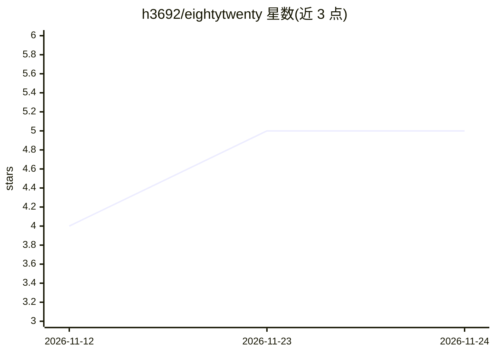

# h3692/eightytwenty

⭐ 5 · Python · MIT · 推送 2026-11-23 · [GitHub](https://github.com/h3692/eightytwenty) · [官网](https://www.eightytwenty.tech) · 个人维护 · 中文 README

**给 AI 助手提供案例赛做片方法论与 900+ 版式库的 MCP 连接器**

以远程 MCP 服务器形式提供：将案例竞赛团队的做片方法（提问引导、storyline、逐页计划、QA 审核）与 900+ 抽象线框版式、39 套整副流程的版式库暴露给 Claude、ChatGPT 等任何 MCP 客户端。搜索由 Cloudflare Worker 实现，结合 SQLite 全文检索与 bge-m3 嵌入，playbook 以 markdown 提供，全部工具只读。库中不含原片，仅存布局记录与线框，经泄漏检查后上架；免费使用，按客户端限速，MIT 许可可自托管。

## 筛选速览

| 维度 | 判定 | 备注 |
|---|---|---|
| AI 角色 | `ai-knowledge` | 知识聚合/清单类 |
| 许可风险 | `permissive` | MIT |
| 部署形态 | `None` |  |
| 模型依赖 | — | README 未给出锁定关系 |
| 硬件要求 | — | 无带数字的原话,不猜 |
| 安装摩擦 | `low` | 无编译、无系统依赖或容器化 |
| 成熟度 | — | 结构信号不足 |

## 能力要点

- 5 个只读 MCP 工具：方法手册、版式检索、整副流程检索、详情读取、图片检索
- 搜索组合 SQLite 全文检索与 bge-m3 嵌入，托管于 Cloudflare Worker
- 版式库为抽象线框记录，入库前经自动泄漏检查与人工复核
- 无需账号与 API key，MIT 许可支持自托管

## 适用场景

- 让 Claude/ChatGPT 按案例竞赛方法逐步生成路演或提案幻灯片
- 按幻灯片用途、行业、数据类型检索参考版式
- 为并购 pitch 等场景选择整副结构流程
- 为某一页搜索公有领域图标、logo 与照片

## 场景标签

 · 领域:演示文稿/AI 连接器

## 证据(README 行号)

> L3:  A case-competition playbook and 900 slide layouts, inside your AI assistant.
> L17: eightytwenty gives your assistant the method strong case-competition teams use to build decks. It asks the right qu
> L88: Every tool is read-only. Nothing can list, export or upload to the library.

## 星数曲线

2026-11-12 4 → 2026-11-24 5（+1）

---
*卡片 v1 · prompt 1.4 · 生成 2026-11-21 · 置信度 high · 依据 README sha `974a7864a095` · [字段定义](../../DATASET.md)*
