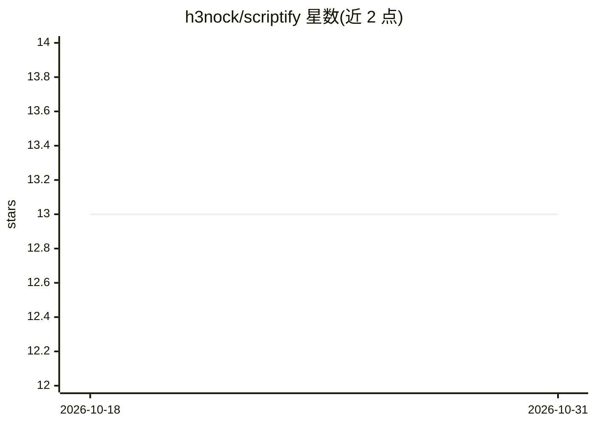

# h3nock/scriptify

⭐ 13 · Python · 推送 2025-12-09 · [GitHub](https://github.com/h3nock/scriptify) · [官网](https://scriptify.h3nok.dev/) · 个人维护

**基于 LSTM+attention 的手写合成端到端项目：训练到部署**

PyTorch 实现的手写序列生成系统，复现 Alex Graves 论文的 3 层 LSTM + soft attention + GMM 输出模型，在 IAM On-Line Handwriting 数据集上训练。覆盖完整流程：数据处理、单/多 GPU（DDP）可断点续训训练、模型打包、FastAPI 推理服务与 React 前端。训练需自行获取 IAM 数据集，推荐 CUDA GPU，通过 Conda 环境安装依赖，并提供 HuggingFace Space 部署模板。

## 筛选速览

| 维度 | 判定 | 备注 |
|---|---|---|
| AI 角色 | `ai-native` | 本体是模型或模型工具 |
| 许可风险 | `none` | — |
| 部署形态 | `library` | 以包/库形式分发 |
| 模型依赖 | — | README 未给出锁定关系 |
| 硬件要求 | — | 无带数字的原话,不猜 |
| 安装摩擦 | `medium` | 含编译或系统依赖之一 |
| 成熟度 | — | 结构信号不足 |

## 能力要点

- 3 层 LSTM + soft attention + GMM 输出的手写笔画生成模型
- 多 GPU DDP 训练与可恢复检查点
- FastAPI 推理服务与 React 前端
- Weights & Biases 日志（可选）

## 适用场景

- 复现 Graves 手写生成论文并训练自己的手写模型
- 搭建手写合成的训练与推理 API 服务
- 通过 Web 前端体验手写生成效果

## 场景标签

`图像生成` `模型训练` `推理引擎` · 领域:内容生成

## 证据(README 行号)

> L5: Built on PyTorch with an LSTM + attention model trained on the IAM On‑Line Handwriting Database. Based on Alex Grave
> L9: - Train LSTM + attention with GMM output on IAM

## 星数曲线

2026-10-18 13 → 2026-10-31 13（+0）

---
*卡片 v1 · prompt 1.4 · 生成 2026-10-31 · 置信度 mid · 依据 README sha `2b0ccace115a` · [字段定义](../../DATASET.md)*
