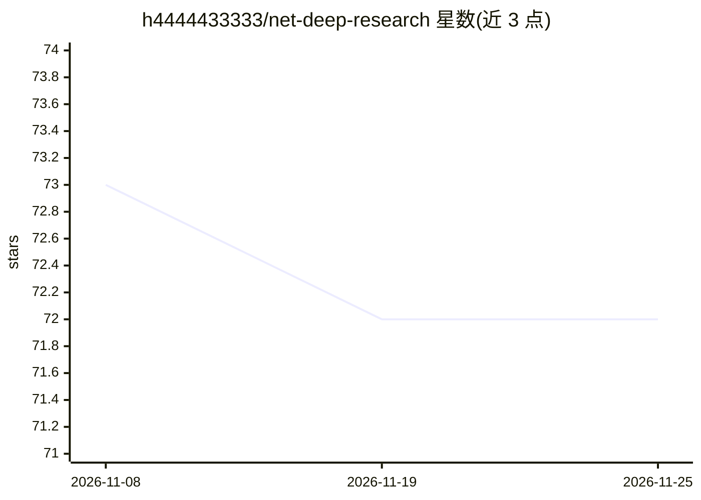

# h4444433333/net-deep-research

⭐ 72 · Python · MIT-0 · 推送 2026-08-25 · [GitHub](https://github.com/h4444433333/net-deep-research) · 个人维护 · 中文 README

**给 AI agent 的网络深度研究技能包：来源核验与证据结构化**

面向 AI agent 的公开技能包，同时以 pip CLI、Python 库和 MCP server 三种形式提供：在回答前进行实时网络搜索、查询外部来源信誉后端（shoguothis 后端仅客户端随仓库分发）、抓取前做 URL 安全检查与危险链接过滤，并交叉核验关键声明，输出结论、证据与推断的结构化分离，可生成含 A/B/C/U 分级与引用护照的 PDF 报告。支持安装到 Trae、Claude Code、Cursor、Codex、OpenCode、OpenClaw 等 agent 宿主，也可通过 Claude Desktop 等 MCP 客户端调用；需要 Python>=3.10 与有效 LLM_API_KEY（OpenAI 兼容后端）。

## 筛选速览

| 维度 | 判定 | 备注 |
|---|---|---|
| AI 角色 | `ai-ecosystem` | LLM/agent 周边工具 |
| 许可风险 | `permissive` | MIT-0 |
| 部署形态 | `library` | 以包/库形式分发 |
| 模型依赖 | — | README 未给出锁定关系 |
| 硬件要求 | — | 无带数字的原话,不猜 |
| 安装摩擦 | `low` | 无编译、无系统依赖或容器化 |
| 成熟度 | — | 结构信号不足 |

## 能力要点

- 抓取前的 URL 安全检查与危险站点过滤
- 声明交叉核验与 A/B/C/U 证据分级、引用护照
- 技能包 / pip CLI / MCP server 三种交付形式，pip 安装零第三方依赖
- 暴露 deep_research(question) 与 check_source(url) 两个 MCP 工具

## 适用场景

- 让 agent 做需要多源交叉核验的深度网络研究
- 引用敏感的研究问题中区分已验证事实与推断
- 政策查询与最新信息核验时过滤弱来源与可疑 URL

## 场景标签

`科研工具` · 领域:学习与行业

## 证据(README 行号)

> L14: `Net Deep Research` is a public skill bundle for AI agents that need to verify information on the live web, detect 
> L29: - A. Skill install: install into Trae, Claude Code, Cursor, Codex, OpenCode, or OpenClaw
> L81: |**A. Skill install**|Agent hosts (Trae, OpenCode, Claude Code, Codex, Cursor, OpenClaw)|

## 星数曲线

2026-11-08 73 → 2026-11-25 72（-1）

---
*卡片 v1 · prompt 1.4 · 生成 2026-11-18 · 置信度 high · 依据 README sha `79296725c25f` · [字段定义](../../DATASET.md)*
