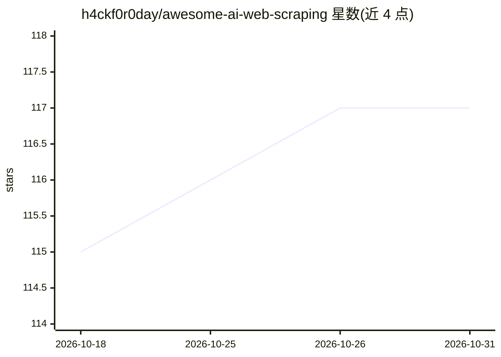

# h4ckf0r0day/awesome-ai-web-scraping

⭐ 117 · CC0-1.0 · 推送 2026-05-18 · [GitHub](https://github.com/h4ckf0r0day/awesome-ai-web-scraping) · 个人维护

**AI 网页抓取工具策展清单：框架、API、MCP 服务与数据集**

策展类清单仓库，收录 AI/LLM 参与抓取的工具与资源，按自建框架库、托管 API、面向 agent 的浏览器基础设施、无代码抓取器、MCP 服务器、面向 LLM 的搜索 API、代理与反爬基础设施、预抓取数据集、基准与研究、教程等类别组织。收录范围限定 AI 或 LLM 在抽取、导航或内容理解中起实质作用的工具，通用爬虫与自主浏览器 agent 明确排除在外。面向构建 RAG 管线、agent 与 LLM 应用的开发者做选型参考。许可证为 CC0。

## 筛选速览

| 维度 | 判定 | 备注 |
|---|---|---|
| AI 角色 | `ai-knowledge` | 知识聚合/清单类 |
| 许可风险 | `viral` | CC0-1.0 |
| 部署形态 | `library` | 以包/库形式分发 |
| 模型依赖 | — | README 未给出锁定关系 |
| 硬件要求 | — | 无带数字的原话,不猜 |
| 安装摩擦 | `low` | 无编译、无系统依赖或容器化 |
| 成熟度 | — | 结构信号不足 |

## 能力要点

- 覆盖自建框架、托管 API、MCP 服务器等 10+ 个类别的条目
- 明确界定收录范围：AI/LLM 参与抽取、导航或内容理解
- 含数据集与基准（Common Crawl、FineWeb、SWDE 等）

## 适用场景

- 为 LLM/RAG 管线挑选网页抓取工具
- 查找面向 Claude/Cursor 等 LLM 客户端的抓用 MCP 服务器
- 对比托管抓取 API 与自建方案的条目信息

## 场景标签

`精选清单` · 领域:学习与行业

## 证据(README 行号)

> L5: A curated list of tools, libraries, and resources for AI-powered web scraping.
> L9: **Scope:** Tools where AI or LLMs play a meaningful role in extraction, navigation, or content understanding. Genera

## 星数曲线

2026-10-18 115 → 2026-10-31 117（+2）

---
*卡片 v1 · prompt 1.4 · 生成 2026-10-23 · 置信度 mid · 依据 README sha `fa496728900e` · [字段定义](../../DATASET.md)*
