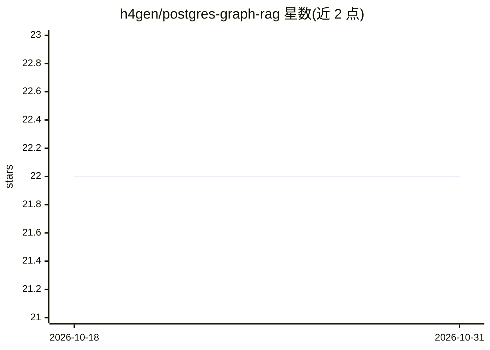

# h4gen/postgres-graph-rag

⭐ 22 · Python · MIT · 推送 2025-12-22 · [GitHub](https://github.com/h4gen/postgres-graph-rag) · 个人维护

**在 PostgreSQL 内实现 Graph RAG 的 Python 库**

面向已有 PostgreSQL 数据库的开发者的 Graph RAG 库：用 pgvector 存向量，节点与关系同库存储，通过 SQL Recursive CTE 做多跳图遍历，替代 LLM-agent 循环；抽取由托管 SLM（OpenAI/Gemini，可配置）完成。支持异步 Python、懒加载连接池、自定义分块器注入与 namespace 多租户隔离；JSONB 元数据设计避免 schema 迁移。README 自述为早期版本，混合检索与实体合并仍在路线图中。

## 筛选速览

| 维度 | 判定 | 备注 |
|---|---|---|
| AI 角色 | `ai-ecosystem` | LLM/agent 周边工具 |
| 许可风险 | `permissive` | MIT |
| 部署形态 | `library` | 以包/库形式分发 |
| 模型依赖 | — | README 未给出锁定关系 |
| 硬件要求 | — | 无带数字的原话,不猜 |
| 安装摩擦 | `low` | 无编译、无系统依赖或容器化 |
| 成熟度 | `idea` | |

## 能力要点

- SQL Recursive CTE 实现多跳图遍历，不依赖 LLM-agent 循环
- 向量、节点、关系统一存于 Postgres，单事务保证一致性
- namespace 多租户隔离与 JSONB 免迁移 schema 设计
- 原生异步 Python 与懒加载连接池

## 适用场景

- 在现有 Postgres 库上搭建关系感知的 RAG，不引入图数据库
- 多用户/多项目场景下按 namespace 隔离知识图
- 需要增量摄取而非批量重建的知识图谱应用

## 场景标签

`RAG` · 领域:知识与检索

## 证据(README 行号)

> L5: ### High-Precision GraphRAG. Native to PostgreSQL.
> L18: * **Recursive Retrieval:** Instead of expensive LLM-agent loops, we use **SQL Recursive CTEs** to perform multi-hop
> L31: pip install postgres-graph-rag

## 星数曲线

2026-10-18 22 → 2026-10-31 22（+0）

---
*卡片 v1 · prompt 1.4 · 生成 2026-10-27 · 置信度 high · 依据 README sha `eda4688f1a0c` · [字段定义](../../DATASET.md)*
