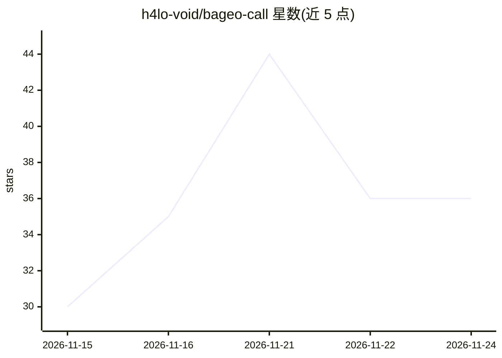

# h4lo-void/bageo-call

⭐ 51 · Rust · AGPL-3.0 · 推送 2026-11-22 · [GitHub](https://github.com/h4lo-void/bageo-call) · 个人维护 · 中文 README

**自托管的 AI 电话助理：用备用 root 安卓机接打你的号码**

Gemini Live 驱动的电话助理：用户将 SIM 插入一部经 Magisk/KernelSU root 的备用安卓机（已测试 Pixel 7/7a/8/9），来电经 USB/Wi-Fi 传给电脑上的 Bageo 程序，AI 在一声铃后接听并对话。功能包括识别并拖延推销/诈骗电话（最长 30 分钟）、录音/文字记录/摘要、按一句话指令代打电话（不确定时先询问）、9 种语言应答、32 个通知渠道。需自备 Gemini API key，按 Google 计费；实时语音不可离线，摘要可选 Ollama 本地模型。AGPL-3.0 双许可（另有商业许可）。

## 筛选速览

| 维度 | 判定 | 备注 |
|---|---|---|
| AI 角色 | `ai-native` | 本体是模型或模型工具 |
| 许可风险 | `dual` | AGPL-3.0 |
| 部署形态 | `None` |  |
| 模型依赖 | local-ok | 支持本地模型 |
| 硬件要求 | — | 无带数字的原话,不猜 |
| 安装摩擦 | `low` | 无编译、无系统依赖或容器化 |
| 成熟度 | — | 结构信号不足 |

## 能力要点

- 一声铃后接听，接通后约 0.43 秒出声（实测中位数）
- 诈骗/推销电话拖延模式（最长 30 分钟），输出录音、记录与摘要
- 一句话指令代打电话，超出指令范围时先询问用户
- 支持 9 种语言，双卡各 SIM 可配置不同语言

## 适用场景

- 让 AI 替我接听真实手机号的来电并留下摘要
- 用拖延模式消耗诈骗和推销电话的时间
- 让 AI 代为订餐位、询问库存等日常电话事务
- 海外来电时用对应语言应答

## 场景标签

`语音 Agent` `AI 助手` · 领域:对话与助手

## 证据(README 行号)

> L5:  AI phone assistant for your real phone number: Gemini Live answers and makes your calls.
> L101:  How Bageo works: the caller reaches your spare rooted phone over the mobile network; the phone passes the call au
> L103: The phone only carries the call; everything else runs on your own computer. The AI connects while the phone is sti

## 星数曲线

2026-11-15 30 → 2026-11-24 36（+6）

---
*卡片 v1 · prompt 1.4 · 生成 2026-11-18 · 置信度 high · 依据 README sha `f4aa2423355b` · [字段定义](../../DATASET.md)*
