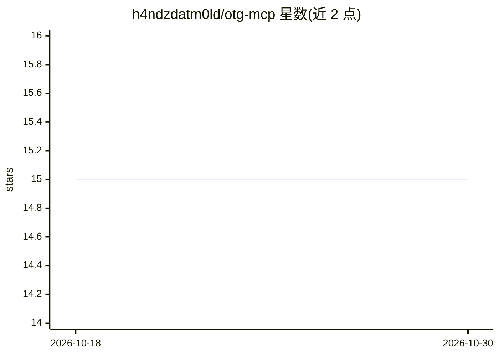

# h4ndzdatm0ld/otg-mcp

⭐ 15 · Python · Apache-2.0 · 推送 2026-10-26 · [GitHub](https://github.com/h4ndzdatm0ld/otg-mcp) · 个人维护

**通过 MCP 协议接入 Open Traffic Generator 的流量测试服务器**

Python 实现的 Model Context Protocol 服务器，把 Open Traffic Generator（OTG）API 暴露给 MCP 客户端：通过 JSON 配置文件定义流量发生器目标与端口，支持同时连接多个目标，提供配置下发、流量启停、协议指标（BGP/OSPF/IS-IS 等）与捕获、健康检查等工具。Schema 按目标动态拉取其自身 OpenAPI 文档并按目标缓存。附带 Ansible 角色将裸 Linux 主机部署为 OTG 发生器（Ixia-C 容器、可选 DPDK）。要求 Python 3.11+，提供 Docker 镜像与源码安装两种方式。

## 筛选速览

| 维度 | 判定 | 备注 |
|---|---|---|
| AI 角色 | `ai-ecosystem` | LLM/agent 周边工具 |
| 许可风险 | `permissive` | Apache-2.0 |
| 部署形态 | `self-host` | docker 或自建部署 |
| 模型依赖 | — | README 未给出锁定关系 |
| 硬件要求 | — | 无带数字的原话,不猜 |
| 安装摩擦 | `low` | 无编译、无系统依赖或容器化 |
| 成熟度 | — | 结构信号不足 |

## 能力要点

- 完整实现 Open Traffic Generator API 的 MCP 服务器
- 多流量发生器目标同时连接
- 按目标动态拉取并缓存 OpenAPI schema
- Ansible 角色部署 Ixia-C 容器与可选 DPDK 绑定的流量发生器

## 适用场景

- 在 MCP 客户端中以自然语言/工具调用方式驱动流量发生器做网络测试
- 配置流量、启停测试并采集 BGP/OSPF 等协议指标
- 用 Ansible 把 Linux 主机部署为可被本服务器驱动的 OTG 发生器

## 场景标签

 · 领域:网络测试/自动化

## 证据(README 行号)

> L5: MCP (Model Context Protocol) server implementation for Open Traffic Generator (OTG) API.
> L9: The OTG MCP Server is a Python-based Model Context Protocol (MCP) to provide access to Open Traffic Generators (OTG)
> L130: When integrating with an MCP client application, you can use the following configuration example to specify the OT

## 星数曲线

2026-10-18 15 → 2026-10-30 15（+0）

---
*卡片 v1 · prompt 1.4 · 生成 2026-10-30 · 置信度 mid · 依据 README sha `2e3ca1337b25` · [字段定义](../../DATASET.md)*
