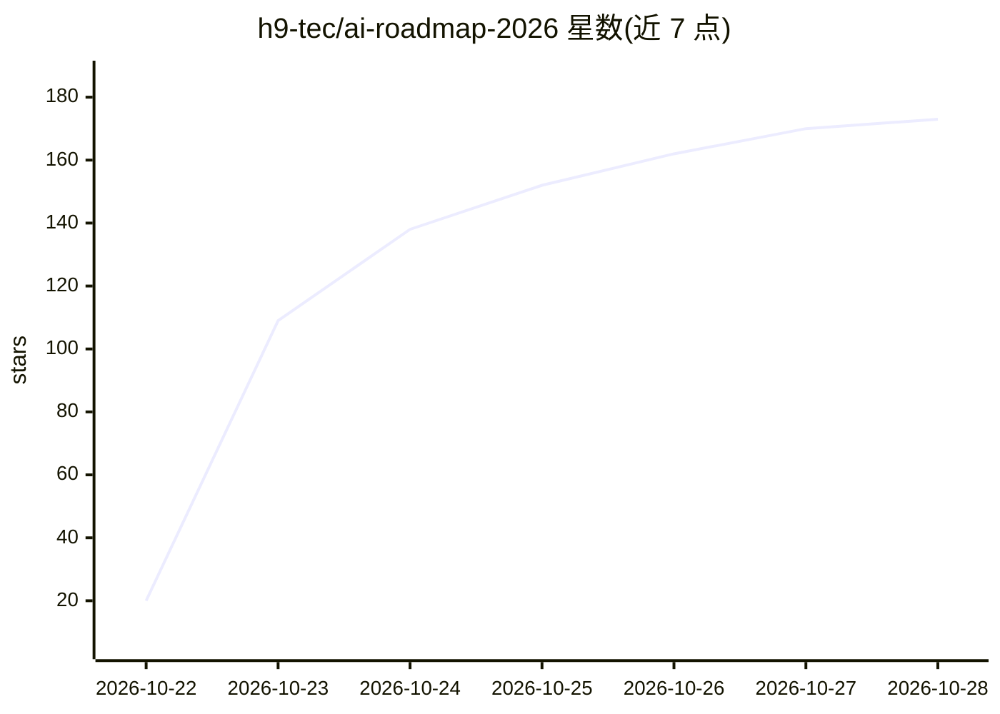

# h9-tec/ai-roadmap-2026

⭐ 173 · CC-BY-4.0 · 推送 2026-10-21 · [GitHub](https://github.com/h9-tec/ai-roadmap-2026) · 个人维护

**AI 工程师学习路线图：五层进阶路径配免费资源与小项目**

面向初学者的 AI 工程师学习路线图，将学习路径分为 Foundations、LLM Engineering、Agents、Evaluation、Production 五层，每层以一个 mini-project 收尾（如 LLM proxy API、带引用的文档问答、研究 agent）。基于 2026 年市场分析，聚焦 RAG、Agents、Evals 三项技能。按每周约 10 小时估算，五层约需 25 周，另提供 12 周示例计划。资源链接经过验证且免费，内容以 CC BY 4.0 许可发布。

## 筛选速览

| 维度 | 判定 | 备注 |
|---|---|---|
| AI 角色 | `ai-knowledge` | 知识聚合/清单类 |
| 许可风险 | `viral` | CC-BY-4.0 |
| 部署形态 | `None` |  |
| 模型依赖 | — | README 未给出锁定关系 |
| 硬件要求 | — | 无带数字的原话,不猜 |
| 安装摩擦 | `low` | 无编译、无系统依赖或容器化 |
| 成熟度 | — | 结构信号不足 |

## 能力要点

- 五层结构：Foundations → Production(LLMOps)，每层配 mini-project
- 所有资源链接经过验证且免费
- 提供 12 周示例计划与逐层两种学习路径
- 内容以 CC BY 4.0 许可发布

## 适用场景

- 从零开始按层进阶成为 AI 工程师
- 按 12 周计划有节奏地学习 RAG、Agents 与 Evals
- 查找经过验证的免费 AI 工程学习资源

## 场景标签

`教程课程` `精选清单` · 领域:学习与行业

## 证据(README 行号)

> L3:  AI Roadmap 2026: from zero to AI engineer in five layers
> L13:  The route: five lines from Foundations to Production, each with its stations and the project you build at the end

## 星数曲线

2026-10-22 20 → 2026-10-28 173（+153）

---
*卡片 v1 · prompt 1.4 · 生成 2026-10-23 · 置信度 high · 依据 README sha `8274a4af84a1` · [字段定义](../../DATASET.md)*
