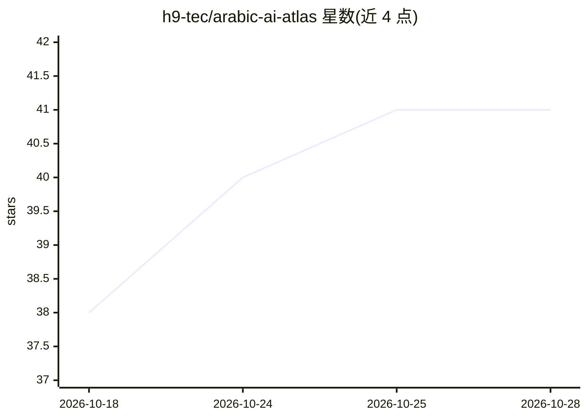

# h9-tec/arabic-ai-atlas

⭐ 41 · Python · MIT · 推送 2026-10-27 · [GitHub](https://github.com/h9-tec/arabic-ai-atlas) · 个人维护

**阿拉伯语 AI 生态地图与清单，可装成 agent 技能**

覆盖阿拉伯语 LLM、ASR、TTS、OCR、嵌入、数据集、基准等条目的策展图谱：以交互地图、按国家/类型的 README 表格和可下载的 dist/atlas.json、llms.txt 三种形式发布。数据源为手工维护的 YAML，CI 校验 PR，夜间任务拉取 Hugging Face 下载数并重建地图。仓库本身打包为 Claude Code 插件（5 个技能 + 一个离线读取图谱的 MCP 服务器），提供 recommend、lineage 等 MCP 工具；也可作为通用 MCP server 接入任意客户端，需 uv 在 PATH。

## 筛选速览

| 维度 | 判定 | 备注 |
|---|---|---|
| AI 角色 | `ai-knowledge` | 知识聚合/清单类 |
| 许可风险 | `permissive` | MIT |
| 部署形态 | `None` |  |
| 模型依赖 | locked-api |  |
| 硬件要求 | — | 无带数字的原话,不猜 |
| 安装摩擦 | `low` | 无编译、无系统依赖或容器化 |
| 成熟度 | — | 结构信号不足 |

## 能力要点

- 按国家/类型组织的阿拉伯语 AI 条目清单（LLM/ASR/TTS/OCR/嵌入/数据集等）
- 夜间任务拉取 Hugging Face 下载量并自动重建地图与 README
- 以 Claude Code 插件形式提供 5 个技能 + 离线 MCP 服务器（recommend/lineage 工具）
- 数据以 YAML 为唯一手工源，CI 按 schema 校验

## 适用场景

- 查找特定阿拉伯国家或方言的开源 ASR/TTS/LLM 模型
- 让 Claude 等 agent 通过 MCP 工具离线查询并推荐阿拉伯语 AI 模型
- 了解阿拉伯语 AI 生态各类型条目的分布与下载热度

## 场景标签

`精选清单` · 领域:学习与行业

## 证据(README 行号)

> L1: Map of the Arabic AI ecosystem: entries per Arab country, with one bubble per entry type sized by downloads
> L7: **The Arabic AI ecosystem as a map, a list, and a skill your agent can install.**
> L40: - The repo is itself a Claude Code plugin: 5 skills + an MCP server that reads the atlas offline.

## 星数曲线

2026-10-18 38 → 2026-10-28 41（+3）

---
*卡片 v1 · prompt 1.4 · 生成 2026-10-25 · 置信度 high · 依据 README sha `b1ee0ada1fc5` · [字段定义](../../DATASET.md)*
