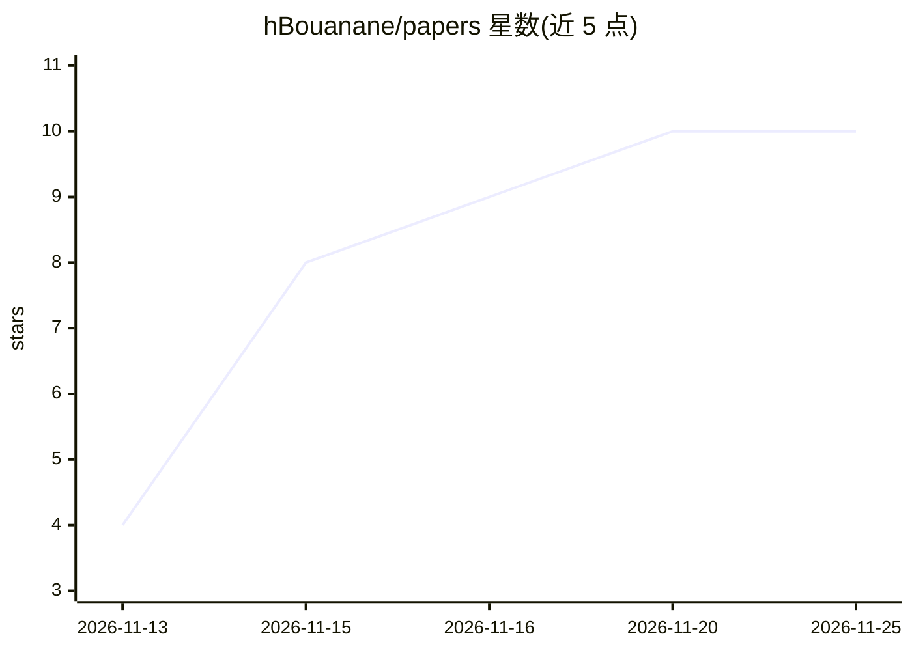

# hBouanane/papers

⭐ 10 · Python · MIT · 推送 2026-11-23 · [GitHub](https://github.com/hBouanane/papers) · 个人维护

**研究论文的 AI 阅读伴学工具：选文、带读、复习**

面向论文阅读场景的自托管桌面/Web 应用：以目标为起点，检索 Semantic Scholar 与 arXiv 后由 AI 生成阅读路线图并自动下载 PDF；阅读时可选中段落做解释、简化、翻译，回答带章节/图表引用，支持 Quick/Deep 两种对话模式与图表、交互小部件；并有要点、测验、间隔复习与 Recall 语义检索。库以本地文件夹存储，支持 uvx、pipx、Docker 与源码运行，需 Python 3.11+。

## 筛选速览

| 维度 | 判定 | 备注 |
|---|---|---|
| AI 角色 | `ai-native` | 本体是模型或模型工具 |
| 许可风险 | `permissive` | MIT |
| 部署形态 | `self-host` | docker 或自建部署 |
| 模型依赖 | local-ok | 支持本地模型 |
| 硬件要求 | — | 无带数字的原话,不猜 |
| 安装摩擦 | `low` | 无编译、无系统依赖或容器化 |
| 成熟度 | — | 结构信号不足 |

## 能力要点

- 目标驱动的阅读路线图：按基础→方法→前沿排序并附理由与时长
- 全文感知的选段问答：Explain/Simplify/Translate，回答引用章节与图表
- Deep 模式可搜索论文、读章节、看图并操作笔记（带 Undo）
- 间隔复习、测验与 Recall：用自己的话描述找回读过的位置

## 适用场景

- 入门一个新领域时按 AI 路线图依次读论文
- 阅读中让 AI 解释公式、术语或论文插图
- 用测验与间隔复习巩固读过的内容
- 事后凭模糊印象找回某段论述的出处

## 场景标签

`科研工具` · 领域:学习与行业

## 证据(README 行号)

> L3:  An AI reading companion for research papers.
> L24: - **Start from a goal.** Say what you're trying to understand. Papers searches Semantic Scholar and arXiv and the A
> L33: It runs on your computer. Your library (papers, notes, highlights, conversations) is a folder on your disk, and you

## 星数曲线

2026-11-13 4 → 2026-11-25 10（+6）

---
*卡片 v1 · prompt 1.4 · 生成 2026-11-20 · 置信度 mid · 依据 README sha `f6afcd03cac4` · [字段定义](../../DATASET.md)*
