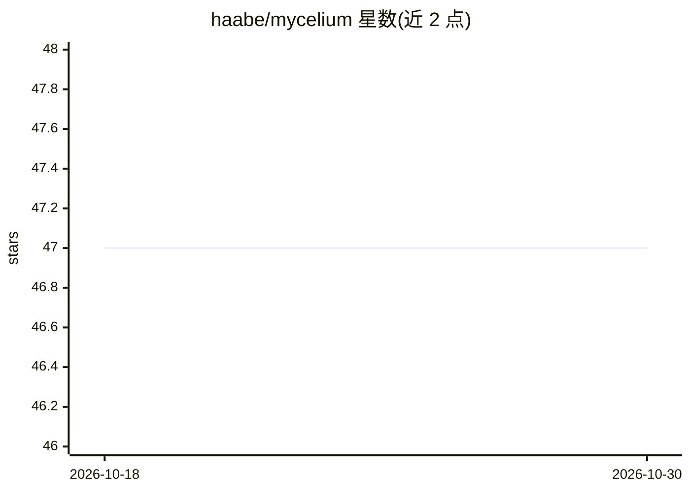

# haabe/mycelium

⭐ 47 · Python · MIT · 推送 2026-10-28 · [GitHub](https://github.com/haabe/mycelium) · [官网](https://github.com/haabe/mycelium/blob/main/docs/get-started.md) · 个人维护

**Claude Code 插件：用四问门槛约束 AI 编程代理先验证再动工**

构建于 Claude Code 的插件，文件与技能可移植到 opencode、Codex、Cursor。机制为钩子式门槛：代理在目的/spec 未写入仓库前无法创建新源码文件；交付需打开写明理由的 delivery diamond；面向真人发布需记录触达对象。通过 /mycelium:start 回答四个问题（问题、对象、假设、证伪信号）生成 spec，答案以 YAML 留存于仓库，git 中可回溯。限制：每个仓库只问一次、schema 随小版本变动、pre-1.0，多画布协同未实现；约每会话消耗六千 token。卸载为 /plugin uninstall。

## 筛选速览

| 维度 | 判定 | 备注 |
|---|---|---|
| AI 角色 | `ai-ecosystem` | LLM/agent 周边工具 |
| 许可风险 | `permissive` | MIT |
| 部署形态 | `None` |  |
| 模型依赖 | — | README 未给出锁定关系 |
| 硬件要求 | — | 无带数字的原话,不猜 |
| 安装摩擦 | `low` | 无编译、无系统依赖或容器化 |
| 成熟度 | `idea` | |

## 能力要点

- 创建新源码文件前强制完成四问 spec，答案留存仓库
- 交付/发布/新 diamond 各有带理由的钩子门槛，可显式跳过且需用户同意
- 文件与技能可移植到 opencode、Codex、Cursor
- 卸载后画布保留为普通 YAML 可读

## 适用场景

- 我想让 AI 编程代理在动手前先写清问题和假设
- 我想把产品决策的理由留在 git 里供日后回看
- 我想在周末项目里用轻量门槛避免构建错误的东西

## 场景标签

 · 领域:开发工具/AI 编程代理流程治理

## 证据(README 行号)

> L7: Built on Claude Code, where the gates are structural. The files and skills port to opencode, Codex and Cursor.
> L44: It puts the questions where your agent works, and it makes the agent earn its first source file.
> L87: Some hooks hold work back, and here is what each kind holds. Before anything is written down, the agent cannot crea

## 星数曲线

2026-10-18 47 → 2026-10-30 47（+0）

---
*卡片 v1 · prompt 1.4 · 生成 2026-10-25 · 置信度 high · 依据 README sha `5696c364bc60` · [字段定义](../../DATASET.md)*
