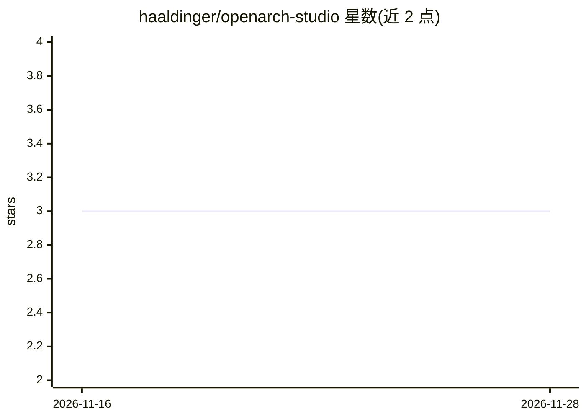

# haaldinger/openarch-studio

⭐ 3 · Python · Apache-2.0 · 推送 2026-10-29 · [GitHub](https://github.com/haaldinger/openarch-studio) · 组织维护

**基于 Hyland/OpenArch 的权限感知 AI 文档工作区概念验证**

作为附加组件运行在 Hyland/OpenArch 部署之上，克隆进 OpenArch 检出目录后一条 docker compose 命令同时启动双方。上传文档经 Docling（Tika 兜底）抽取文本，本地模型分块、嵌入并回写为 OpenArch SysEmbeddings 子对象，还做文档分类与字段抽取。提供关键词/语义/混合/HXQL 四种检索、带引用的 RAG 问答与知识图谱，所有检索与问答以登录用户身份执行，仅引用其有权阅读的内容。需 Docker 与 Git；重排序服务可选。

## 筛选速览

| 维度 | 判定 | 备注 |
|---|---|---|
| AI 角色 | `ai-native` | 本体是模型或模型工具 |
| 许可风险 | `permissive` | Apache-2.0 |
| 部署形态 | `self-host` | docker 或自建部署 |
| 模型依赖 | local-ok | 支持本地模型 |
| 硬件要求 | — | 无带数字的原话,不猜 |
| 安装摩擦 | `low` | 无编译、无系统依赖或容器化 |
| 成熟度 | — | 结构信号不足 |

## 能力要点

- 以调用者身份执行所有 OpenArch 调用，ACL 在检索与问答中持续生效
- Docling 抽取 + 本地嵌入（Ollama）+ 交叉编码器重排序（可选）
- 混合检索（kNN + BM25 经 RRF 合并）与带引用、带检索轨迹的流式问答
- Demo 模式按角色对比同一问题的差异回答，支持实时权限撤销与限时访问

## 适用场景

- 在企业内容平台上演示按权限隔离的 RAG 问答
- 用自然语言查询发票等文档并获得可点开的引用出处
- 向不同角色展示同一问题的差异化授权答案

## 场景标签

`RAG` `语义搜索` `知识图谱` `模型评测` · 领域:评测与运维

## 证据(README 行号)

> L11: Studio is an add-on to the public Hyland/OpenArch
> L17: it four ways and ask an agent questions whose answers are grounded in — and cited from — only the
> L59: |`studio-api`|`./api` (FastAPI)|Session gateway, enrichment, search, RAG, graph.|

## 星数曲线

2026-11-16 3 → 2026-11-28 3（+0）

---
*卡片 v1 · prompt 1.4 · 生成 2026-11-22 · 置信度 high · 依据 README sha `bf0849ac632a` · [字段定义](../../DATASET.md)*
