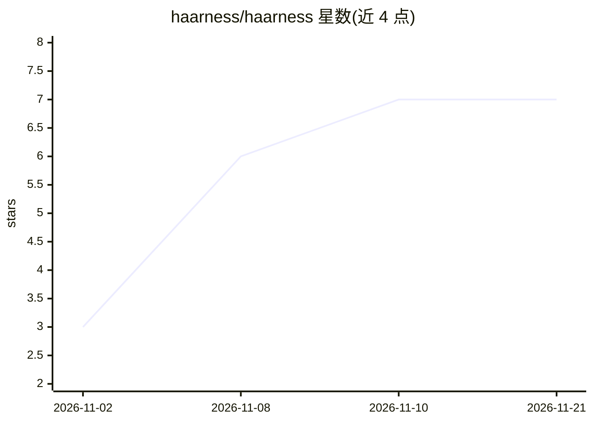

# haarness/haarness

⭐ 7 · Rust · Apache-2.0 · 推送 2026-11-19 · [GitHub](https://github.com/haarness/haarness) · [官网](https://haarness.ai) · 组织维护

**开源 AI 编码代理：终端、桌面与编辑器多端协作**

Haarness 是一个支持任意模型的开源 AI 编码代理，以单个 Rust 可执行文件提供 CLI、终端 UI 与桌面应用，并可通过 Agent Client Protocol 接入编辑器、脚本与 CI。本地服务器保存全部会话、轮次与工具调用，窗口关闭或断连后任务继续。模型接入方式包括 ChatGPT/GitHub Copilot 订阅登录、各家 API key、本地 Ollama/LM Studio 及自带的 Haarness Router。权限分 Review/Auto/Yolo 三档，所有读取、命令与编辑记录在 transcript 中。

## 筛选速览

| 维度 | 判定 | 备注 |
|---|---|---|
| AI 角色 | `ai-native` | 本体是模型或模型工具 |
| 许可风险 | `permissive` | Apache-2.0 |
| 部署形态 | `desktop` | 安装包/桌面程序 |
| 模型依赖 | local-ok | 支持本地模型 |
| 硬件要求 | — | 无带数字的原话,不猜 |
| 安装摩擦 | `medium` | 含编译或系统依赖之一 |
| 成熟度 | — | 结构信号不足 |

## 能力要点

- 一个代理覆盖终端 UI、桌面、编辑器（ACP）、脚本与 CI 等客户端
- 支持订阅登录、API key、本地 Ollama/LM Studio 与自托管 Router 多种模型接入
- 会话与工具调用由本地服务器持久化，断连/崩溃后不重跑命令
- MCP（stdio/HTTP/SSE+OAuth）、Agent Skills、插件与自定义 agent/斜杠命令扩展

## 适用场景

- 在终端或桌面里让 AI 读写代码、改完自动跑测试
- 通过 haarness run 把代码审查或摘要嵌进脚本与 CI 流程
- 编辑器中通过 ACP 使用同一份持久化会话
- 手机端跟进并审批代理在自己电脑上的任务

## 场景标签

`编码 Agent` `代码审查` · 领域:编码与开发

## 证据(README 行号)

> L3:  Haarness — Open-source AI coding agent.
> L14: **Haarness is an open-source AI coding agent that works with any model.** Bring your ChatGPT or
> L28: **One agent, every screen.** The terminal UI, Desktop, your editor (through the Agent Client Protocol),

## 星数曲线

2026-11-02 3 → 2026-11-21 7（+4）

---
*卡片 v1 · prompt 1.4 · 生成 2026-11-20 · 置信度 high · 依据 README sha `7371ab2ce6b5` · [字段定义](../../DATASET.md)*
