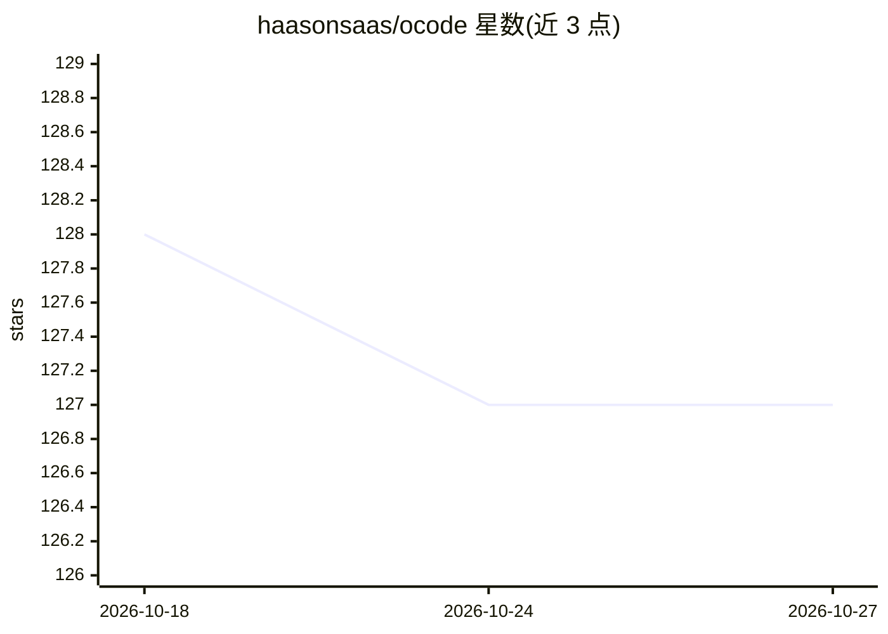

# haasonsaas/ocode

⭐ 127 · Python · NOASSERTION · 推送 2026-05-18 · [GitHub](https://github.com/haasonsaas/ocode) · 个人维护

**终端 AI 编程助手：基于本地 Ollama 模型执行开发任务**

在 shell 中运行的 AI 编程助手，直接对接本地或远程 Ollama 服务流式获取补全，无需代理。功能覆盖代码生成与多文件重构、项目架构分析、Git 工作流、测试执行、JSON/YAML 数据处理与进程监控等；内置 19+ 分类工具（文件、文本、数据、系统、开发、集成），支持 MCP 协议接入第三方集成。提供一键安装脚本与 pip/pipx 多种安装方式，运行需 Python 3.8+ 与 Ollama 服务。

## 筛选速览

| 维度 | 判定 | 备注 |
|---|---|---|
| AI 角色 | `ai-native` | 本体是模型或模型工具 |
| 许可风险 | `none` | NOASSERTION |
| 部署形态 | `self-host` | docker 或自建部署 |
| 模型依赖 | local-ok | 支持本地模型 |
| 硬件要求 | — | 无带数字的原话,不猜 |
| 安装摩擦 | `low` | 无编译、无系统依赖或容器化 |
| 成熟度 | — | 结构信号不足 |

## 能力要点

- 直连本地/远程 Ollama 流式补全，无需代理
- 19+ 分类工具覆盖文件、git、测试、数据与系统操作
- MCP 协议插件层支持第三方集成
- 支持单次提示、交互会话与 JSON 流式输出

## 适用场景

- 在终端用自然语言完成多文件重构或生成测试
- 让 AI 分析项目架构并跟踪依赖
- 通过对话执行 git 提交、测试与构建流程

## 场景标签

`编码 Agent` · 领域:编码与开发

## 证据(README 行号)

> L5: OCode is a sophisticated terminal-native AI coding assistant that provides deep codebase intelligence and autonomous
> L13: - **Direct Ollama integration** – streams completions from local/remote Ollama without proxies

## 星数曲线

2026-10-18 128 → 2026-10-27 127（-1）

---
*卡片 v1 · prompt 1.4 · 生成 2026-10-22 · 置信度 mid · 依据 README sha `3126b4387b8c` · [字段定义](../../DATASET.md)*
