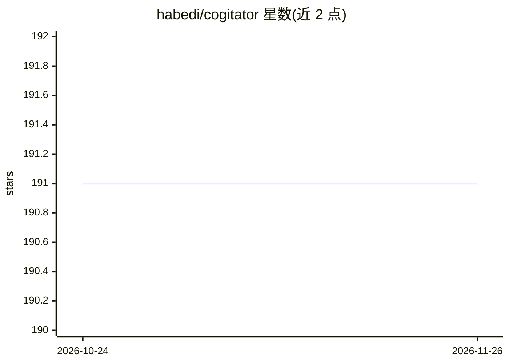

# habedi/cogitator

⭐ 191 · Python · MIT · 推送 2026-10-29 · [GitHub](https://github.com/habedi/cogitator) · [官网](https://habedi.github.io/cogitator/) · 个人维护

**帮助研究者与开发者实验思维链提示的 Python 工具库**

Python 库，用于实验和使用大模型中的思维链（CoT）提示方法：提供统一的同步/异步 API、Pydantic 结构化输出校验，内置 Self-Consistency、Automatic CoT、Least-to-Most、Tree of Thoughts、Graph of Thoughts 等已发表策略的实现，并附带可定制的基准评测框架，可在 GSM8K、StrategyQA 等数据集上评估各策略。支持 OpenAI、Ollama、OpenRouter 作为 LLM 提供方，以 MIT 许可发布。

## 筛选速览

| 维度 | 判定 | 备注 |
|---|---|---|
| AI 角色 | `ai-ecosystem` | LLM/agent 周边工具 |
| 许可风险 | `permissive` | MIT |
| 部署形态 | `library` | 以包/库形式分发 |
| 模型依赖 | local-ok | 支持本地模型 |
| 硬件要求 | — | 无带数字的原话,不猜 |
| 安装摩擦 | `low` | 无编译、无系统依赖或容器化 |
| 成熟度 | — | 结构信号不足 |

## 能力要点

- 内置 6 种已发表 CoT 策略实现（含 Tree/Graph of Thoughts）
- 统一的同步/异步 API，Pydantic 结构化输出校验
- 可定制的基准评测框架，覆盖 GSM8K 与 StrategyQA
- 支持 OpenAI、Ollama、OpenRouter 作为 LLM 提供方

## 适用场景

- 在自己的数据集上对比不同 CoT 策略的效果
- 将思维链策略集成进 AI 应用
- 做推理过程可解释性的相关研究

## 场景标签

`提示工程` `模型评测` · 领域:Agent 开发

## 证据(README 行号)

> L14: Cogitator is a Python toolkit for experimenting and working with
> L20: The toolkit aims to make it easier to use popular CoT strategies and frameworks for research or integrating them in
> L26: * Supports using OpenAI, Ollama, and OpenRouter as LLM providers

## 星数曲线

2026-10-24 191 → 2026-11-26 191（+0）

---
*卡片 v1 · prompt 1.4 · 生成 2026-11-26 · 置信度 high · 依据 README sha `5a8ec249fedf` · [字段定义](../../DATASET.md)*
