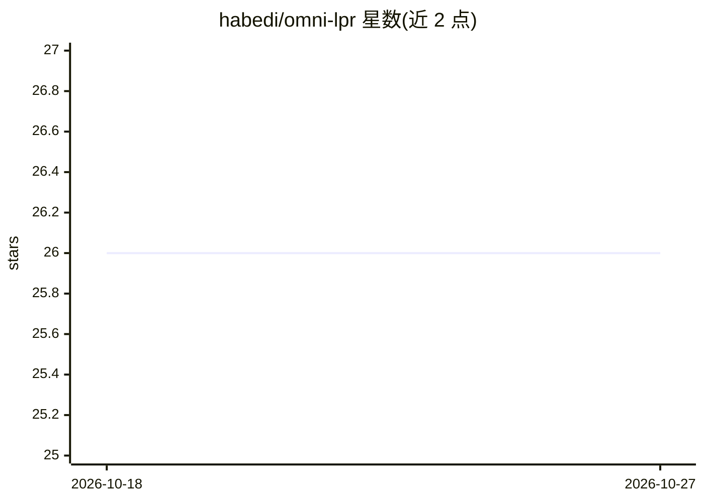

# habedi/omni-lpr

⭐ 26 · Python · MIT · 推送 2026-07-05 · [GitHub](https://github.com/habedi/omni-lpr) · 个人维护

**自托管的车牌识别服务器，提供 REST 与 MCP 双接口**

以 REST API 和 Model Context Protocol（MCP）两种接口提供自动车牌识别（ALPR）能力的可自托管服务器，可作为独立 ALPR 微服务，也可作为 AI agent 与 LLM 的工具箱。内置工具包括列出模型、识别预裁剪车牌图、检测并识别整图车牌（支持 Base64/文件上传/URL 路径输入）。基于 Starlette 构建，提供 CPU（ONNX）、Intel CPU（OpenVINO）与 NVIDIA GPU（CUDA）三种预构建 Docker 镜像，使用 fast-plate-ocr 与 fast-alpr 库。README 声明项目处于早期开发阶段，可能出现 bug 与 API 破坏性变更。

## 筛选速览

| 维度 | 判定 | 备注 |
|---|---|---|
| AI 角色 | `ai-native` | 本体是模型或模型工具 |
| 许可风险 | `permissive` | MIT |
| 部署形态 | `library` | 以包/库形式分发 |
| 模型依赖 | — | README 未给出锁定关系 |
| 硬件要求 | — | 无带数字的原话,不猜 |
| 安装摩擦 | `medium` | 含编译或系统依赖之一 |
| 成熟度 | `idea` | |

## 能力要点

- REST API 与 MCP（streamable HTTP）双接口暴露 ALPR 工具
- 提供 CPU/OpenVINO/CUDA 三种预构建 Docker 镜像
- 支持 ONNX、OpenVINO、CUDA 的硬件加速路径
- 可用 LM Studio 等 MCP 客户端接入

## 适用场景

- 为主应用提供与语言解耦的车牌识别微服务
- 让 AI agent 或 LLM 通过 MCP 调用车牌识别工具
- 对整图或预裁剪车牌图批量识别车牌文本

## 场景标签

`OCR` `目标检测` · 领域:感知与多模态

## 证据(README 行号)

> L18: A multi-interface (REST and MCP) server for automatic license plate recognition
> L20: Omni-LPR is a self-hostable server that provides automatic license plate recognition (ALPR) capabilities via a REST
> L21: and the Model Context Protocol (MCP). It can be used both as a standalone ALPR microservice and as an ALPR toolbox 
> L22: AI agents and large language models (LLMs).

## 星数曲线

2026-10-18 26 → 2026-10-27 26（+0）

---
*卡片 v1 · prompt 1.4 · 生成 2026-10-26 · 置信度 high · 依据 README sha `9c269da63779` · [字段定义](../../DATASET.md)*
